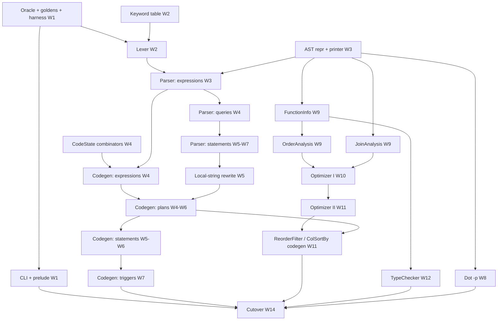

# AQuery Compiler — Scala → q Rewrite Plan

| | |
|---|---|
| Status | Draft v1, for PI review (no compiler code written yet) |
| Date | 2026-10-07 |
| Reference implementation | `aquery-master/src/main/scala/edu/nyu/aquery/**` at commit `6abb7aae` (25 files, 5,082 lines of Scala) |
| Runtime reused unchanged | `aquery-master/src/main/resources/q/base.q` (775 lines; already q) |
| Proposed q project | `aquery-q/` (sibling of `aquery-master/`) |
| Duration | 14 weeks + 2 buffer weeks |

---

## 0. Executive summary

AQuery is a SQL dialect with order/array semantics (`ASSUMING ASC/DESC`, order-dependent aggregates such as `sums`, `prev`, `avgs`). The existing compiler is written in Scala and runs on the JVM. It parses `.a` programs with Scala parser combinators. It can optionally run a "soft" type check (`-tc`) and seven order-aware plan rewrites (`-a 1`). It then emits a `.q` file containing the `base.q` runtime followed by q functional-form queries. There is no separate IR; the relational-algebra part of the AST (`RelAlg`) serves as the logical plan that the optimizer rewrites and the code generator lowers directly to q text.

**Strategy in one paragraph.** Freeze the Scala compiler as an *oracle*. Build a differential harness on day one that captures Scala's behavior at every stage (tokens, AST with source positions, optimized AST, type errors, generated q, Graphviz output). Then rewrite in **vertical slices** ordered by the language subset the real corpus needs. The ordering is measured, not guessed: the 73 programs in `aquery-master/src/test` split into five cumulative feature tiers (1 / 25 / 12 / 19 / 16 programs). Each week ends with more programs compiling **byte-identically** to Scala. Scala bugs are reproduced by default ("bug-compatible") and recorded in a divergence register; fixing them is a separate, PI-approved decision.

### 0.1 Verified findings (from running the existing compiler on 2026-10-07)

1. **There are two jars, and they disagree.** The root `aquery.jar` (the one the top-level `README.md` tells people to use) predates the July/October source changes (`TableColumnValue`, `rewriteLocalStringConstants`). `aquery-master/target/scala-2.11/aquery.jar` contains those changes. 6 of the 71 programs compared compile differently under the two jars. **The oracle must be pinned to a build of HEAD.**
2. **Corpus.** `src/test` contains 81 `.a` programs. 73 compile with the current compiler at both `-a 0` and `-a 1`. The 8 failures are all `AQuery2/` files written in a different dialect; they become negative (parse-error) tests.
3. **Checked-in `.q` files are not usable as goldens.** 56 `.a` files have a `.q` next to them, but only 38 equal the current compiler's output at either optimization level (31 at `-a 0`, 29 at `-a 1`). The rest come from older compiler versions or an older embedded `base.q`. Goldens must be regenerated from the pinned oracle.
4. **Output is deterministic.** The same input gave the same hash over 3 runs.
5. **Stage-level oracle without sbt is feasible.** A ~20-line Java class compiled with `javac -cp aquery.jar` calls `AqueryParser$.MODULE$.apply(src)` and `new BasicOptimizer(prog, Nil).optimize()` and prints the Scala case-class `toString`. A prototype was run successfully.
6. **Scala bugs that affect equivalence** (full register in §1.19). For example, `-x` generates `(.aq.neg}; …)`, which is invalid q. `!x` cannot be lexed at all. Timestamp literals compile to *symbols*. `-tc` crashes with `scala.MatchError` on any program containing triggers or `LOAD`.
7. **Toolchain on the development machine.** Java 17 is present; `q` and `sbt` are **not installed**. Installing them is a Week-1 blocker.

### 0.2 Headline schedule (details in §11.C)

The `-a 0` and `-a 1` columns count corpus programs (out of 73) whose generated q matches Scala byte-for-byte. "Constructs" counts language/tool features from Appendix A1 (79 total).

| Week | Milestone | `-a 0` | `-a 1` | Constructs | Scala LOC covered |
|---|---|---|---|---|---|
| 1 | Oracle, goldens, harness, q skeleton | 0 | 0 | 0 | ~1% |
| 2 | Lexer complete; first byte-identical output | 1 | 1 | 9 | ~8% |
| 3 | AST + expression parser; AST-level parity | 1 (26 AST-identical) | 1 | 9 | ~24% |
| 4 | Single-table queries end-to-end | 26 | — | 40 | ~37% |
| 5 | GROUP BY, WITH, UDFs, FROM-functions | 38 | — | 50 | ~46% |
| 6 | Joins, DDL/DML, LOAD/SAVE | 57 | — | 64 | ~54% |
| 7 | Triggers: **full `-a 0` parity** | **73** | — | 69 | ~63% |
| 8 | Graphviz `-p`, parse-error parity, CLI, fuzzer v1 | 73 | — | 71 | ~70% |
| 9 | FunctionInfo + Order/Join analysis | 73 | — | 71 | ~83% |
| 10 | Optimizer I (5 rewrites) | 73 | AST-level | 76 | ~88% |
| 11 | Optimizer II + optimized codegen: **full `-a 1` parity** | 73 | **73** | 78 | ~92% |
| 12 | Soft type checker `-tc` | 73 | 73 | **79** | **100%** |
| 13 | Runtime equivalence, 10k fuzz, performance | 73 | 73 | 79 | 100% (VERIFIED) |
| 14 | Cutover: Scala dependency removed, docs, v1.0 | 73 | 73 | 79 | 100% |
| 15–16 | Buffer | | | | |

---

## 1. Understanding the existing compiler (architecture)

### 1.1 Entry point and CLI — `Aquery.scala`

`object Aquery extends App`. Flags are parsed by the tail-recursive pattern matcher `parseConfig(config, args)` into `AqueryConfig(action, optim, silence, typeCheck, optimFuns, input, output)`:

| Flag | Effect | Notes |
|---|---|---|
| `-c` | action = `Compile` (default) | If both `-p` and `-c` are given, the last one wins |
| `-p` | action = `Graph` (Graphviz DOT) | |
| `-a N` | optimization level; any non-zero value enables `BasicOptimizer` | |
| `-opts a,b` | subset of optimizations; empty means all | Unknown names throw `java.lang.Exception("Unknown optimizations: …")` |
| `-tc` | soft type checking | |
| `-s` | "silence warnings" | Parsed but **has no effect**; no warnings exist |
| `-o f` | output file; default stdout | |
| `-h` / invalid | prints `help()` + optimizer `description`, exits 1 | |
| last arg | input file; default stdin | |

Pipeline orchestration (lines 86–129):
1. Read the input with `Source.getLines().mkString("\n")`. This normalizes line endings and drops the final newline.
2. Parse with `AqueryParser(contents)`.
3. If `-tc`: errors are sorted by `(line, column)` and printed, then `System.exit(1)` if any exist.
4. If `-a ≠ 0`: optimize.
5. Run `Dot.toGraph` or `KdbGenerator.generate`.
6. Print to the output stream.

Verified edge behaviors:
- A **parse failure prints `[line.col] failure: msg`**, a blank line, the source line, and a caret line to *stdout*. It then **exits 0**, and with `-o` an **empty output file is still created**.
- Type errors exit 1 and create no file.
- Uncaught exceptions print a JVM stack trace to stderr and exit 1.

### 1.2 Pipeline (actual)

```
.a source (file | stdin)
   │  Aquery.scala: getLines().mkString("\n")
   ▼
LEXING ─ AqueryParser.AqueryLexical ⊂ AqueryTokens ⊂ StdLexical
   │  tokens: Keyword(reserved words AND delimiters) | Identifier | NumericLit | StringLit
   │          | Date | Verbatim | ErrorToken | EOF        (each with offset → line/col)
   ▼
PARSING ─ AqueryParser (StandardTokenParsers + PackratParsers), entry `program`
   │  ordered-choice PEG semantics; left recursion via packrat; positions via `positioned`
   ▼
AST ─ List[TopLevel]: Query(local WITH queries, RelAlg main) | VerbatimCode | UDF | Create | Insert
   │                  | Update | Delete | Load | Save | Trigger | DropTrigger
   │  parse-time desugaring: SELECT clauses → SortBy→Filter→GroupBy→Project→TopApply chain;
   │  predicates → FunCall("BETWEEN"/"IN"/"LIKE"/"NULL"/"OVERLAPS"/"NOT"); builtins upper-cased;
   │  unary minus folded into numeric literals
   ▼
POST-PARSE REWRITE ─ AqueryParser.rewriteLocalStringConstants (only for queries with WITH)
   │  local("col") → TableColumnValue;  string-constant projections → aqConst* helper calls
   │  + a VerbatimCode with helper definitions prepended to the program
   ▼
[-tc] SOFT TYPE CHECK ─ TypeChecker(FunctionInfo + UDF arity summaries) → Seq[AnalysisError]
   ▼
[-a ≠ 0] OPTIMIZATION ─ BasicOptimizer(prog, -opts)   (Query and CREATE … AS query only)
   │  OrderAnalysis (FunctionInfo + UDF order summaries), JoinAnalysis (attr annotations)
   │  7 ordered RelAlg→RelAlg rewrites per plan; adds ReorderFilter, ColSortBy nodes
   ▼
BACKEND (exactly one)
   ├─ -c: KdbGenerator.generate  (State-monad codegen; codegen-internal lowerings:
   │       HAVING → Filter(GroupBy), SortBy → ColSortBy(*), COUNT(*) → COUNT(ROWID),
   │       trigger transition plans, UPDATE/DELETE boolean-vector sub-plans)
   │       → base.q text + "// Translation begins here" + statements joined by "\n\n"
   └─ -p: Dot.toGraph → Graphviz DOT
   ▼
OUTPUT (-o file | stdout)
   ▼  (outside the compiler)
kdb+/q executes the .q file: .aq.* query helpers + .trg.* trigger runtime from base.q
```

### 1.3 Source language

AQuery top-level statements are **juxtaposed with no separators** (`program = rep1(io | fullQuery | verbatim | udf | delete | update | dropTrigger | trigger | create | insert)`).

- **Queries:** `[WITH n[(c,…)] AS (q) …] SELECT [DISTINCT] e [AS n],… FROM src [ASSUMING ASC|DESC e,…] [WHERE p AND …] [GROUP BY e [AS n],… [HAVING e AND …]]`, plus `SHOW(q)`, `DISTINCT(q)`, `EXEC ARRAYS(q)`.
- **FROM sources:** `t [AS] alias`, function sources `f(args)`, left-associative comma cross joins, `INNER JOIN … USING c | (c,…)`, `FULL OUTER JOIN … USING …`.
- **Expressions:** precedence `|` < `&` < `= !=` < `< <= > >=` < `+ -` < `* /` < `^` (right-associative) < unary `-` (operand is a base expression only). Also function calls (32 built-in keywords plus identifiers), `CASE [e] WHEN … THEN … [ELSE …] END`, `t.c`, `ROWID`, `*`, `e[EVEN|ODD|EVERY n]`, and literals (int, float, `"string"`, `'MM/dd/yyyy'` date, `'MM/dd/yyyyDHH:mm:ss[.n]'` timestamp, `TRUE`/`FALSE`).
- **Predicates (WHERE only):** `[NOT] BETWEEN`, `[NOT] IN`, `[NOT] LIKE`, `IS [NOT] TRUE|FALSE`, `IS [NOT] NULL`, `(a,b) [NOT] OVERLAPS (c,d)`.
- **DDL/DML:** `CREATE TABLE t (c TYPE,…)` / `CREATE TABLE t <query>`, `INSERT INTO t [(cols)] [ASSUMING …] VALUES(…) | <query>`, `UPDATE t SET c = e,… [ASSUMING][WHERE][GROUP BY … [HAVING …]]`, `DELETE FROM t …` (rows) and `DELETE c,… FROM t` (columns).
- **I/O:** `LOAD DATA INFILE "f" INTO TABLE t FIELDS TERMINATED BY ","`, `<query> INTO OUTFILE "f" FIELDS TERMINATED BY ","`.
- **UDFs:** `FUNCTION f(x,y){ a := e; …; e }`.
- **Triggers:** `CREATE TRIGGER n BEFORE|AFTER INSERT|UPDATE|DELETE ON t [REFERENCING NEW|OLD TABLE AS a …] DO <update|delete|insert|query>`, `DROP TRIGGER n`.
- **Embedded q:** `<q> … </q>`.
- **Lexical rule:** 102 keywords. A keyword is reserved only in ALL-UPPER or all-lower spelling (`Select` is an identifier). Type names (`INT FLOAT STRING BOOLEAN DATE TIMESTAMP`) are reserved in upper case only, so `date` and `timestamp` are usable column names.

### 1.4 Target language / generated representation

The output is q source text:
1. The full `base.q` text, read via the classloader in `getPrelude`.
2. The line `// Translation begins here`.
3. One block per top-level statement, joined with `"\n\n"`, plus a final `"\n"`.

A query becomes `.aq.qN:{ … };\n.aq.qN[]`. Each RelAlg operator becomes an assignment to a temporary table `aq__tN` using **q functional forms** `?[t;w;b;p]` (select) and `![t;w;b;p]` (update/delete). The where, by, and projection arguments of those forms are **q parse trees**, for example `(>; {x^.aq.cd x} `c1; 2)`. Column names are resolved at *runtime* through the column dictionary `.aq.cd` (`{x^.aq.cd x} `col`), which `.aq.initTable`/`.aq.gencd` maintain. DML and DDL go through runtime helpers (`.aq.insert`, `.aq.update`, `.aq.deleteRows`), which fire triggers via `.trg.run`.

### 1.5 Lexer — `parse/AqueryTokens.scala` + `AqueryParser.AqueryLexical` (lines 21–51)

- Whitespace and comments come from `StdLexical`: `//…` and non-nested `/* … */`.
- Identifiers are `letter|_` followed by `letter|digit|_`, where "letter" is any Unicode letter. `processIdent` turns reserved words into `Keyword` tokens.
- **Keywords are collected by Java reflection** over every `Keyword`-typed member of `AqueryParser` (lines 171–176 and `builtin` at 646–654). 32 of the 102 keywords are marked `fun = true` (built-in functions).
- Numbers: both kinds are `NumericLit` tokens; the parser treats `digits '.' digits*` as a float and anything else as an int. There are no exponents and no leading `.`.
- Strings are double-quoted with no escapes, and must not span a newline.
- Dates: a fixed 10-character window is parsed with non-lenient `SimpleDateFormat("MM/dd/yyyy")` and re-formatted.
- Timestamps: a fixed 19-character window (`MM/dd/yyyy'D'HH:mm:ss`), optionally followed by `.digits`. The result is re-emitted as a **`StringLit`** token (bug B3).
- Verbatim: `<q>…</q>` is kept raw.
- Delimiters: the list at lines 48–50, matched longest-first. A lone `!` is **not** a delimiter (bug B2).
- Errors become `ErrorToken`: `unclosed string literal`, `unclosed/invalid date/timestamp`, `illegal character`.

### 1.6 Parser — `parse/AqueryParser.scala`

- **Framework:** Scala parser combinators 1.0.4, `StandardTokenParsers with PackratParsers`. This means **ordered choice (PEG)** semantics and memoization. Left recursion is handled by the packrat seed-growing algorithm; the left-recursive rules are `expr`, `and`, `eq`, `rel`, `add`, `mult`, `from`, and `indexExpr`/`baseExp`.
- **Productions:** `program`, `fullQuery`, `localQuery`, `topApply`, `query`, `projection`, `from`, `using`, `simpleTable`, `bottomApply`, `order`, `orderPair`, `where`, `predicate`, `range`, `groupBy`, `group`, `verbatim`, `update`, `elemUpdate`, `delete`, `insert`, `modInsert`, `srcInsert`, `create`, `trigger`, `triggerTime`, `triggerEvent`, `triggerRefs`, `triggerRef`, `triggerBody`, `dropTrigger`, `schema`, `schemaEntry`, `typeLabel`, `io`, `udf`, `udfBody`, `expr`, `and`, `eq`, `rel`, `add`, `mult`, `pow`, `unary`, `indexExpr`, `indexOp`, `caseExpr`, `whenThen`, `funCall`, `builtin`, `baseExp`, `lit`, `tableExp`, `bool`, `date`, `timestamp`, `id`.
- **Positions:** `positioned(p)` sets `pos` only if the node still has `NoPosition` (line 0, column 0). Some nodes therefore never get a position. Verified examples: the `Filter`, `SortBy`, and `GroupBy` nodes built inside `query` (only the outermost `Project`/`TopApply` receives the query's position), `IfThen`, `Assign`, and the inner `FunCall` of `NOT BETWEEN`.
- **Error reporting:** `phrase` returns the *furthest* failure recorded in `lastNoSuccessVar` (on ties, the later attempt wins). Messages look like ``` ``-'' expected but ErrorToken(…) found ``` or `end of input`.
- **API:** `parse(prod, s)` parses any production (the tests use this heavily). `apply(s)` parses a whole program.

### 1.7 AST — `ast/*.scala`

| File | Contents |
|---|---|
| `AST.scala` | `abstract class AST[A] extends Positional`; `dotify(currAvail): (String, Int)`; `transform(PartialFunction)` + `transform0` = `f.applyOrElse(this, identity)` |
| `expr.scala` | `Expr` (`children`, `allSubExpressions`); `Id`; `BinExpr` + 13 `BinOp` case objects; `UnExpr` + `Not`/`Neg`; `FunCall`; `ArrayIndex` + `Even`/`Odd`/`Every(n)`; `Case`/`IfThen`; literals `IntLit(Long)`, `FloatLit(Double)`, `StringLit`, `DateLit`, `BooleanLit`, `TimestampLit`; `TableColumnValue(t,c)`; `TableExpr` = `RowId`/`ColumnAccess(t,c)`/`WildCard` |
| `query.scala` | `Analyzable` (`attr: Map[Any,Any]`, `setAttr`, `clearAttr`); `RelAlg` (`expr`, `children`, `find`, `findp`, `takeWhile`, bottom-up `transform`); `Query(local, main, attr)`; `Project`, `Filter` (`FiltersData`), `GroupBy`, `SortBy` + `Asc`/`Desc`, `Table`, `TopApply`, `BottomApply`, `Join` + `InnerJoinUsing`/`FullOuterJoinUsing`/`InnerJoinOn`/`Cross`; `ModificationQuery` = `Update`, `Delete(Either[List[Id], List[Expr]])` |
| `data.scala` | `Create(n, Either[schema, Query])`, `Insert(n, order, modifier, Either[values, Query])`, `DataIO` = `Load`, `Save` |
| `udf.scala` | `UDF(n, args, List[Either[Assign, Expr]])`, `Assign` |
| `trigger.scala` | `Trigger(name, time, event, table, refs, body: TopLevel)`, `DropTrigger`, enums `Before/After`, `Insert/Update/DeleteEvent`, `NewTableRef/OldTableRef` |
| `types.scala` | `TypeName` = `TypeInt/Float/String/Date/Timestamp/Boolean` |
| `TopLevel.scala` | marker trait + `dotify` dispatch |
| `VerbatimCode.scala` | raw q (`CHAR_LIMIT = 100` for DOT labels) |
| `Dot.scala` | `declareNode`, `declareEdge`, `strList` (id-threading fold), `toGraph` |

Equality is case-class structural equality. It **ignores positions** but **includes `attr`**; this matters for `Set` deduplication and for the tests.

### 1.8 Normalization / desugaring

There is no separate normalization pass. Desugaring happens in three places:
1. **Parser semantic actions.** Clause chaining in `query`; predicates become `FunCall`s; unary minus is folded into literals; built-in names are upper-cased; `SELECT DISTINCT` becomes `TopApply("DISTINCT")`.
2. **`rewriteLocalStringConstants`.** This uses a `LinkedHashSet` to collect helper names in first-seen order.
3. **The code generator.** HAVING becomes `Filter(GroupBy(…, Nil))`; `SortBy` becomes `ColSortBy(…, Set(WildCard))`; `COUNT(*)` becomes `COUNT(ROWID)`. Synthesized RelAlg plans appear in `genBooleanVector`, `genTransitionUpdateTrigger`, and `genTransitionDeleteTrigger`. These internal lowerings *determine temp-table numbering* (`aq__tN`), so the q version must reproduce them exactly.

### 1.9 Semantic analysis, type checking, environments ("symbol tables")

- **`analysis/AnalysisTypes.scala`:** tags `TNumeric`, `TBoolean`, `TString`, `TUnit`, `TTable`, `TUnknown`, and `consistent(Set)`.
- **`analysis/FunctionInfo.scala` + `functionSummaries.scala`:** the function environment, `Map[String, FunctionSummary]`.
  - Built-ins: 17 "normal" functions and 13 order-dependent ones, each with a **partial-function type signature** composed with `orElse`, plus the flags `orderDependent`, `remOrderDependence`, `usesAggregate`.
  - UDF summaries are folded in program order with `FunctionInfo(funs, summarize)`.
- **`analysis/TypeChecker.scala`** (soft; most types are `TUnknown`):
  - Checks binary, unary, call, `CASE`, and literal expressions.
  - Filter, HAVING, and join conditions must be boolean.
  - Sort keys must be `Id`/`ColumnAccess`.
  - `ROWID`/`*`/`t.c` are prohibited in UDF bodies and `INSERT VALUES`.
  - Reports duplicate tables and aliases, unknown correlation names, and ambiguous `t.c`.
  - UDF calls are checked for arity only.
  - Errors (`analysis/errors.scala`): `TypeError`, `BadCall`, `NumArgsError` (never produced), `DuplicateTableName`, `UnknownCorrName`, `AmbigColAccess`, `IllegalExpr`, printed as `Type Error: expected numeric found string at [1,17]`.
- **Compile-time environments:** `FunctionInfo` (functions), `orderEnv: Map[table, sort order]` (optimizer, per full query), the `TABLES_AVAIL` attribute (`JoinAnalysis`), and `CodeState` (codegen).
- **Runtime environment:** column resolution is deferred to q via `.aq.cd`/`.aq.pc` in `base.q`. The compiler keeps no static table or column catalog.

### 1.10 Intermediate representations

1. Token stream.
2. AST (`List[TopLevel]`).
3. **RelAlg logical plan** (inside `Query`). This is the de facto IR.
4. Optimizer-extended plan: `ReorderFilter`, `ColSortBy(cols: Set[Expr])`, and `attr` annotations.
5. Codegen-internal plans: `TransitionUpdatePlan`, `TransitionDeletePlan`, and synthesized RelAlg trees.
6. Generated q, whose expressions are themselves q parse trees.

### 1.11 Optimization — `optimization/BasicOptimizer.scala` (+ `Optimizer.scala` trait)

The seven rewrites run in this fixed order (`optimsAvailable`). `-opts` selects a subset, but the order is preserved.

1. `simplifySort(env, r)`: drops or shortens a `SortBy` over a `Table` whose known order (from an earlier local query) is a prefix of the requested order.
2. `filterBeforeSort`: splits a `Filter(SortBy)` at the first order-dependent predicate (`span`).
3. `embedSort`: rewrites `GroupBy(SortBy)` to `SortBy(GroupBy)` when there are no order-dependent group or having expressions.
4. `simplifyEmbeddedSort`: removes the sort prefix already implied by simple group keys. Matching is exact when a join is present.
5. `pushFiltersJoin`: pushes aggregate-free predicates below joins via `JoinAnalysis.placeFilter` (`foldRight`).
6. `makeReorderFilter`: `cutFilters` splits filter lists at aggregate-using predicates into `ReorderFilter` nodes.
7. `sortToSortCols`: rewrites `SortBy` to `ColSortBy(only the needed columns)`. It uses `OrderAnalysis.colsToSort` or `allCols`, and throws if a plan has more than one sort.

`optimizeQuery` folds over the local queries with **`foldRight`** (bug B7) and builds `orderEnv` from the *unoptimized* plans' `getSort`. Only `Query` and `Create(_, Right(q))` are optimized; `Insert`/`Save`/trigger bodies are not.

Supporting analyses:
- **`analysis/OrderAnalysis.scala`:** `hasOrderDependence` (expr/UDF/name; unknown functions are order-dependent), `usesAggregate`, `removesOrderDependence` (with UDF local-variable tracking), `directOrderDependentCols`, `collectInteractions` (sets of sets), `indirectReachable` (a fixpoint transitive closure in which `c1 ≡ t.c1`), `colsToSort`, `allCols`, `isPrefixSort`, `hasSortBy`, `getSort`.
- **`analysis/JoinAnalysis.scala`:** `tableNamesUsed` (`Option[Set]`; `None` means unknown), `tablesAvailable`, `isEqualitySelection`, `hasJoin`, `annotateWithAvailTableNames` (attr `TABLES_AVAIL`), `placeFilter` (throws on non-join plans).

### 1.12 Code generation — `codegen/KdbGenerator.scala` (1,460 lines, 57 `gen*` methods) + `SimpleState.scala` + `BackEnd.scala`

- **State:** a scalaz `State[CodeState, String]` monad. `CodeState(queryId, tableId, currTable, grouped, nameAsVar, inUDF, renameCols)`, with reset points `cleanTopEnv` (keeps `queryId`) and `cleanQueryEnv` (keeps `queryId` and `tableId`). The **order of effects inside each `for`-comprehension fixes the `aq__tN`/`.aq.qN` numbering**.
- **Expressions (lines 228–466):**
  - `genBinOp` maps operators: `Div` → `%`, `Exp` → `.aq.pow`, `Neq` → `<>`.
  - `genUnExpr` (bug B1).
  - `genId` produces a variable, `.aq.funEnlist x`, or `{x^.aq.cd x} `x`.
  - `genLit`: floats are printed with **Java `Double.toString`**, strings become `` `$"…" ``, dates become `"D"$"…"`.
  - `genFunCall`: `BUILT_INS` arity mangling (`sums` with 2 args → `.aq.sums2`), `VARIADIC` wrapping (`(enlist;…)`), `COUNT(*)` → `ROWID`, the `IN` + `TableColumnValue` special case, and the each modifier `f'` when grouped.
  - Also `genCaseExpr` → `.aq.cond`, `genArrayIndex`, `genTableExpr`.
- **Plans (lines 472–777):** `genTable` (`.aq.initTable`), `genBottomApply`, `genFilter`, `genReorderFilter` (`.aq.reorderFilter`), `inferColName`/`addColNames` (`c__N` names; bug B4), `genGroupBy`, `genProject`, `genExprDict`, `genTopApply`, `genColSortBy`/`genOrderTuples`/`genSortBy` (`.aq.sort`, `.aq.sortGrouped`), `genJoin` (`cross`, `.aq.joinUsing[.aq.ej|.aq.foju;…]`), `genRelabelCols` (`xcol`), `genLocalQuery`, `genPlanInternal`, `genQuery`, `genQueryToVar`.
- **Statements:** `genUDF`/`genAssign`, `genCreate`/`genSchema`/`getTypeCode`, `genDataIO`/`getFileHandle`, `genInsert`, `genUpdate`, `genDelete`, `genBooleanVector` (for HAVING in UPDATE/DELETE), `genTopLevel`, `generate`.
- **Triggers (lines 866–1286):**
  - Transition-plan extraction: `toTransitionUpdatePlan`, `toTransitionDeletePlan`, `extractTransitionAssign`, `extractTransitionKeyPair`, `exprUsesOnlyTables`.
  - Rows sources: `triggerRowsExpr`, `getTriggerRefRowsExpr`.
  - Four emitters: `genTransitionUpdateTrigger`, `genTransitionDeleteTrigger`, `genTriggerDefault`, `genTriggerInsertQueryDefault`.
  - **String surgery on already-generated code:** `injectAfterInit` (finds `.aq.initQueryState[];`), `unwrapImmediateBlock`.
  - `genDropTrigger`.

### 1.13 Runtime dependencies

The generated code depends on kdb+/q (the comments mention 3.3) and the embedded `base.q`:
- **`.aq.*` query runtime:** column dictionary, `initTable`, sort, joins, cond, load/save, insert/update/delete, and 56 built-in aliases.
- **`.trg.*` trigger runtime:** registry, run, ctx helpers, sync helpers.

The compiler itself depends only on the JVM and its libraries (§1.18). **`base.q` is already q, so it is reused, not rewritten.** It will be copied into `aquery-q/runtime/` with a checksum test.

### 1.14 Error handling

| Kind | Scala mechanism | Observable behavior |
|---|---|---|
| Lexical/syntax | `ErrorToken`, `Failure` via `ParseResult` | stdout message + excerpt + caret, exit 0, empty `-o` file |
| Type/semantic (`-tc`) | `Seq[AnalysisError]` | sorted lines to stdout, exit 1 |
| Unknown `-opts` | `throw new Exception` | stack trace on stderr, exit 1 |
| Optimizer invariants | `throw` ("Requires rel alg op with join", "Current optimizer assumes max 1 sort-by in a plan") | stack trace, exit 1 |
| Trigger rows source | `IllegalArgumentException` | stack trace, exit 1 |
| Non-exhaustive match | `scala.MatchError` (e.g. `-tc` + trigger) | stack trace, exit 1 (verified) |

### 1.15 Configuration

There are only CLI flags (`AqueryConfig`). No config files, no environment variables. The prelude is loaded from the classpath resource `q/base.q`.

### 1.16 Utilities, and generic infrastructure vs compiler-specific code

- **Generic infrastructure:**
  - Scala parser combinators (`StdLexical`, `PackratParsers`, `Positional`).
  - `SimpleState` (scalaz `State`).
  - `Dot.declareNode`/`declareEdge`/`strList`.
  - `AST.transform0`, `RelAlg.transform`/`find`/`findp`/`takeWhile`, `Expr.allSubExpressions`.
  - `BackEnd` and `Optimizer` traits.
  - `kdbFunctional`/`kdbSelect`/`kdbUpdate`/`kdbExec`/`kdbSym`/`kdbBool`/`genCodeList`.
- **Compiler-specific:** everything else (grammar, AST nodes, analyses, rewrites, code templates).

The q rewrite replaces the generic layers with small q utilities (§2.3) rather than porting them.

### 1.17 Tests and corpus

| Suite | Cases | What it checks | Comparison style |
|---|---|---|---|
| `ParserTestSuite.scala` | 14 | productions (`expr`, `create`, `trigger`, `io`, `update`, `delete`, `udf`, `from`, `query`) + 4 whole programs parse | AST `==` |
| `TypeCheckerTestSuite.scala` | 8 | expression, UDF, query, and modification checks; 4 programs clean | error non-emptiness, `===` |
| `OrderAnalysisTestSuite.scala` | 7 | order dependence, removal, direct cols, interactions, closure, `colsToSort`, `getSort` | set `===` |
| `JoinAnalysisTestSuite.scala` | 4 | `hasJoin`, `isEqualitySelection`, tables used/available, annotate, `placeFilter` | AST `===` **with** attr |
| `BasicOptimizerTestSuite.scala` | 8 | each rewrite + idempotency + one batch | AST `===` after `clearAttr` |
| `KdbGeneratorTestSuite.scala` | 20 | 10 *runtime* tests (generated q vs hand-written q, via `resources/q/runner.q`, needs `q` on PATH, at `-a 0` and `-a 1`) + 10 trigger *text* tests (`code.contains(…)`) | semantic / substring |
| **Total** | **61 cases, ~215 asserts** | | |

**Program corpus** (in `aquery-master/src/test`): 81 `.a` files. 73 are in scope:
- `benchmark/**`: 26
- `financial/*.a`: 22
- `triggertests/**`: 16
- `resources/*.a`: 4 (`simple`, `fintime`, `monetdb`, `pandas`)
- `function_support/**`: 3
- `AQuery2/join/aquery_kdb`: 2

In total about 2,000 source lines and about 200 top-level statements.

Corpus constructs that never appear, and so need synthetic tests: `INTO OUTFILE`, `LIKE`, `SHOW(…)`, `EXEC ARRAYS`, `[EVEN|ODD|EVERY n]`, `IS [NOT] NULL`, `OVERLAPS`, unary minus on a non-literal, date literals.

### 1.18 External libraries

| Library | Used for | q replacement |
|---|---|---|
| `scala-parser-combinators` 1.0.4 | lexer framework, packrat parser, `Positional`, error messages | hand-written lexer + recursive-descent parser (§2.1) |
| `scalaz-core` 7.2.4 | `State` monad only (`SimpleState`) | explicit state threading (§2.1) |
| `scalatest` 2.2.4 | tests | `aquery-q/tests/qunit.q` (tiny in-house runner) |
| JDK `SimpleDateFormat`, `Double.toString`, `String.split/trim/toLowerCase`, `scala.io.Source.getLines` | literal validation and formatting, text processing | `src/util.q` "Java-compat" helpers with oracle-generated test tables |
| sbt 1.9.8, sbt-assembly, bloop/metals | build | none needed (q is interpreted) |

### 1.19 Behavioral quirk and bug register (seed for `docs/KNOWN_DIVERGENCES.md`)

| ID | Location | Behavior | Reachable? | Default q policy |
|---|---|---|---|---|
| B1 | `KdbGenerator.genUnExpr` | emits `(.aq.neg}; e)` (stray `}`): invalid q for `-x` where `x` is not a literal | yes | replicate |
| B2 | `AqueryLexical.delimiters` | `!` is not a delimiter, so `!x` fails to lex; `UnExpr(Not, …)` is unreachable from source | yes (as an error) | replicate |
| B3 | lexer timestamp branch | timestamps become `StringLit`, emitted as `` `$"01/02/2020D10:11:12.123" ``; `TimestampLit` is unreachable | yes | replicate |
| B4 | `inferColName` | `t1.c` gets the column name literally `t.c` regardless of the table | yes | replicate |
| B5 | `rewriteLocalStringConstants.helperDef` | `` `hello world `` (spaces inside a symbol literal) is invalid q | yes | replicate |
| B6 | `TypeChecker.checkTopLevel` | `MatchError` for `Load`/`Save`/`Trigger`/`DropTrigger` under `-tc` | yes (verified) | replicate the exit code and message class |
| B7 | `BasicOptimizer.optimizeQuery` | `foldRight` over locals: the order env flows from *later* locals to *earlier* ones | yes | replicate |
| B8 | `JoinAnalysis.placeFilter` | a predicate referencing no table (`Some(Set())`) is placed on *every* base table | probably | replicate; confirm via oracle (Week 10) |
| B9 | `Case.transform`, `ArrayIndex.transform` | the else branch is used as the operand; no recursion | **no**: `Expr.transform` is never called | do **not** replicate (dead code) |
| B10 | root `aquery.jar` | stale build; `README.md` points to it | yes | fix in docs (Week 14) |
| B11 | `Aquery.scala` | parse failure exits 0 and creates an empty `-o` file | yes | replicate |
| B12 | various | `NumArgsError` is never produced; `InnerJoinOn` is not parseable; `-s` is a no-op; `toSym`/`indexEven`/`makeNull` in `BUILT_INS` are unreachable via `genFunName` (lower-case lookup in a case-sensitive set) | n/a | replicate |
| B13 | `Keyword.canonical` | mixed-case keywords (`Select`) are identifiers | yes | replicate |

---

## 2. Mapping Scala components to q

### 2.1 Key representation decisions

**D1. AST nodes are tagged general lists with a schema, not dictionaries and not a flat node table.**

```q
/ Scala: BinExpr(Plus, Id(a), IntLit(1)) with positions 1.8 / 1.8 / 1.12
(`BinExpr; `Plus; (`Id; `a; 1 8); (`IntLit; 1; 1 12); 1 8)
/ Scala: Table(t, None, Map())  - None is the generic null; attr is an empty dict
(`Table; `t; ::; ()!(); 1 15)
.aqc.ast.fields:`Id`BinExpr`UnExpr`Table!(enlist`v; `op`l`r; `op`v; `n`alias`attr)
.aqc.ast.get:{[n;f] n 1+.aqc.ast.fields[first n]?f}
```

- The layout is `(kind; field1; …; [attr]; pos)`. Field names and order copy the Scala case class exactly (`Project` = `t`, `ps`, `attr`), so every q node is traceable to its Scala constructor. Kind symbols are the Scala class names, so printing reproduces Scala's `toString` (`InnerJoinUsing`, `TypeInt`, `Asc`) for free.
- **Why not dictionaries?** In q, a list of dictionaries with identical keys silently *becomes a table*, `enlist d` is a one-row table, and `d1,d2` *merges* records instead of appending. Lists of `Id` nodes (function arguments, `USING` columns) would change type depending on their contents. That is a source of hard-to-see equivalence bugs.
- **Why not a flat node table?** The optimizer and code generator rebuild subtrees constantly, and structural equality on a node table needs renumbering. A flat view (`.aqc.ast.flatten → ([] id; parent; kind; …)`) is still provided as a *derived index* for whole-tree queries such as "all `ColumnAccess` nodes" (q-idiomatic and vectorized).
- Constructors (`.aqc.ast.mk.*`) enforce the type gotchas: names are always symbols, string payloads are always `(),x` (a one-character string is otherwise a char atom), and single-element child lists are always `enlist`-ed.

**D2. Sum types and enums become symbols; `Option`, `Either`, and tuples get fixed encodings.**
- `BinOp`, `JoinType`, `OrderDirection`, `TypeName`, `TriggerTime`, … → symbols with the Scala object name. `Every(n)` → `(`Every; n)`.
- `None` → `::`; `Some x` → `x`. `Left x` / `Right x` → `(`Left; x)` / `(`Right; x)`.
- Tuples → fixed-length general lists, e.g. projection `(expr; name-or-::)` and local query `(name; cols; plan)`.

**D3. Pattern matching becomes explicit dispatch dictionaries.** For example, `.aqc.cg.exprGen:`BinExpr`UnExpr`Id…!(…)`. A missing kind signals `'MatchError: <kind>`, which mirrors Scala's `MatchError`. Small enum matches (`genBinOp`, `getTypeCode`, `getOrderDirection`, `getTriggerEventName`, `BinExpr.dotify` labels) become **lookup dictionaries**, e.g. `` `Plus`Minus`Div!("+";"-";"%") ``.

**D4. Partial functions become functions that return `::` for "not defined".**
- Tree rewrites mirror `transform` + `transform0` exactly: rebuild children bottom-up, apply the rule **once** per node, and never revisit the result.

  ```q
  .aqc.ast.transformRel:{[f;r]
    r:.aqc.ast.setChildren[r; .z.s[f] each .aqc.ast.relChildren r];
    $[(::)~n:f r; r; n]}
  ```

- Type signatures (`FunctionInfo.Sig`) return a type symbol, or the null symbol `` ` `` when undefined. `orElse` becomes a 2-line combinator.

**D5. The State monad becomes explicit state threading through a dictionary.** Every generator has the shape `{[s;x] … (s'; code)}`, and `s` is `` `queryId`tableId`currTable`grouped`nameAsVar`inUDF`renameCols!… ``.

```q
/ Scala: genTempTableName() = for (id <- getTableId; _ <- incrTableId) yield "aq__t" + id
.aqc.cg.tempTable:{[s] id:s`tableId; s[`tableId]:id+1; (s; "aq__t",string id)}
```

A `.aqc.cg.seq` fold replaces `SimpleState.sequence`, and a `.aqc.cg.local` helper replaces the save/restore in `genOrderTuples`. This is deliberately more verbose than a global mutable state, but each generator stays pure and unit-testable, and effect order stays visible. Effect order is what fixes the `aq__tN` numbering.

**D6. Sets and maps become lists with explicit equality semantics.** Scala `Set[Expr]` equality ignores positions and keeps the first inserted element. In q:

```q
.aqc.set.distinct:{[xs] k:.aqc.ast.strip each xs; xs k?distinct k}
```

Membership, union, and difference use `~` on stripped nodes, never `in` (which is atomic over list arguments). The transitive closure in `indirectReachable` uses the q **converge** adverb (`f/` until no change), which directly replaces the `@tailrec loop`.

**D7. Function environments become keyed tables.** `.aqc.fi.info:([f:…] sig; orderDependent; remOrderDependence; usesAggregate)`. Built-ins are static rows; UDF summaries are upserted by a fold (`/`) over UDFs in program order, which mirrors `FunctionInfo.apply(init, funs, summarize)`.

**D8. Tokens and errors become tables.** Tokens are `([] kind; text; off; line; col)`, with `line`/`col` computed vectorially from newline offsets (`sums`). Analysis errors are `([] kind; msg; line; col)`; sorting uses `` `line`col xasc `` (stable, like Scala `sortBy`).

**D9. Parsing is recursive descent with one q function per Scala production (same names).**
- Each function has the shape `{[i] … (ok; value; next)}` over a token vector.
- Left-recursive productions become loops (`chainl`).
- Ordered choice is reproduced literally, including alternative order, because alternative order determines both results and error messages.
- A furthest-failure register (`.aqc.p.fail`, reset per parse) mirrors `lastNoSuccessVar`.
- Packrat memoization is *not* needed for correctness; it is an optional performance item (§7).

**D10. Namespaces.** The compiler lives in `.aqc.*` so it never collides with the runtime's `.aq.*`/`.trg.*`. This matters if anyone compiles and runs inside one q session.

**D11. Text output is built from lists of strings and joined once** (`raze`, `sv`). Output is written as raw bytes, so the trailing-newline behavior matches Scala exactly.

### 2.2 Migration table

Difficulty is L (low), M (medium), or H (high). The "Independent?" column says whether the component can be rewritten and tested on its own.

| Scala file / module | Responsibility | Inputs → outputs | Depends on | q equivalent | Diff. | Independent? | Equivalence tests |
|---|---|---|---|---|---|---|---|
| `Aquery.scala` | CLI, pipeline, IO, exit codes | argv, file/stdin → stdout/file, exit code | all | `aquery.q` + `bin/aquery` launcher (`.aqc.cli.*`) | L (M due to q flag clash, §6 R11) | yes (stub stages) | CLI matrix ≈25 cases: stdout bytes, exit code, file existence; help text byte-exact |
| `parse/AqueryTokens.scala` | date, timestamp, verbatim tokens | chars → tokens | `StdLexical` | `src/lex.q` (`.aqc.lex.date/ts/verbatim`) | M | yes | token oracle; date-validity table (leap years, `02/30`), timestamp+nanos, `</q` edge cases |
| `AqueryParser` lexer part (lines 21–51) + keywords (54–176) | tokenization, delimiters, reserved words (reflection) | source → token stream | `AqueryTokens` | `src/lex.q`, `src/keywords.q` (explicit 102-row table) | M | yes | token streams equal for 73 programs + ~40 probes |
| `AqueryParser` grammar (288–695) | all productions, positions, error messages | tokens → `List[TopLevel]` / `ParseResult` | lexer, AST | `src/parse.q` (same production names) | **H** | after lex + AST | AST+positions oracle on corpus, probes, fuzz; 14 ported `ParserTestSuite` cases; error positions |
| `AqueryParser.rewriteLocalStringConstants` (196–286) | WITH-scoped rewrite + helper generation | AST → AST (+ `VerbatimCode`) | AST | `src/rewrite.q` | M | yes | AST oracle on 21 WITH programs + string-constant probes (camel-casing, dedup order) |
| `ast/AST.scala`, `TopLevel.scala` | base types, transform contract | — | — | `src/ast.q` (constructors, `transformRel`, strip, show) | L | yes | printer round-trip vs `toString` |
| `ast/expr.scala` | expression nodes, `children`, `allSubExpressions` | — | AST | `src/ast.q` schema rows | M | yes | expression AST oracle; `allSubExpressions` order test |
| `ast/query.scala` | RelAlg nodes, attr, `find`/`findp`/`takeWhile`, transform, `Update`/`Delete` | — | AST, expr | `src/ast.q` | M | yes | DFS-order tests for `find`/`takeWhile`; transform semantics |
| `ast/data.scala`, `udf.scala`, `trigger.scala`, `types.scala`, `VerbatimCode.scala` | statement nodes | — | AST | `src/ast.q` | L | yes | AST oracle |
| `ast/Dot.scala` + all `dotify` methods | Graphviz rendering with id threading | AST → DOT text | AST | `src/dot.q` (fold with `(text; nextId)` accumulator) | L–M | after AST | `-p` byte-exact for 73 programs at `-a 0` and `-a 1` |
| `analysis/AnalysisTypes.scala` | type tags, `consistent` | — | — | `src/funinfo.q` (symbols) | L | yes | unit |
| `analysis/functionSummaries.scala`, `FunctionInfo.scala` | built-in and UDF summaries, signatures | UDFs → env | AST | `src/funinfo.q` (keyed table) | M | yes | per-built-in signature truth tables generated by the oracle |
| `analysis/errors.scala` | error ADT + messages | — | — | `src/typecheck.q` (error table + formatter) | L | yes | message strings byte-exact |
| `analysis/TypeChecker.scala` | soft type and structure checks | AST → errors | FunctionInfo | `src/typecheck.q` | M | after AST + funinfo | `-tc` stdout and exit code on corpus + ~60 probes; 8 ported cases |
| `analysis/OrderAnalysis.scala` | order dependence, interactions, sort columns | exprs/UDFs → bools, sets | FunctionInfo | `src/order.q` | M–H | after AST + funinfo | oracle probe over every expression in the corpus; 7 ported cases |
| `analysis/JoinAnalysis.scala` | table availability, filter placement | RelAlg → RelAlg | AST | `src/join.q` | M | after AST | 4 ported cases (with attr); `placeFilter` oracle |
| `optimization/Optimizer.scala` | interface | — | — | `src/optimize.q` header | L | — | — |
| `optimization/BasicOptimizer.scala` | 7 rewrites, batching, locals env | AST → AST | Order, Join analysis | `src/optimize.q` | **H** | after analyses | per-rule optimized-AST oracle (`-opts <rule>`) on 73 programs; 8 ported cases; `-a 1` codegen |
| `codegen/SimpleState.scala`, `BackEnd.scala` | state monad, backend trait | — | scalaz | `src/cg/state.q` | M | yes | combinator unit tests (effect order) |
| `codegen/KdbGenerator.scala` expressions (228–466) | expression → q parse tree text | Expr → string | state | `src/cg/expr.q` | M–H | after AST | `-a 0` byte-exact; Java `Double.toString` table |
| `KdbGenerator` plans/queries (472–777) | RelAlg → statements | RelAlg → string | expr | `src/cg/rel.q` | H | after expr | `-a 0` / `-a 1` byte-exact |
| `KdbGenerator` statements (779–865, 1221–1403) | UDF, DDL, DML, IO | TopLevel → string | rel | `src/cg/stmt.q` | M | after rel | byte-exact + runtime tests |
| `KdbGenerator` triggers (866–1286) | plan extraction + templates + string surgery | Trigger → string | stmt | `src/cg/trigger.q` | H | after stmt | 16 trigger programs byte-exact; 10 ported text tests |
| `KdbGenerator.generate`, `getPrelude`, `genTopLevel` (1405–1455) | assembly | program → file text | all cg | `src/cg/generate.q` | L | yes | prelude checksum; framing bytes |
| `resources/q/base.q` | runtime | — | kdb+ | `runtime/base.q` (copy, checksum-locked) | L | yes | sha256 equality |
| `src/test/scala/*.scala` | 61 test cases | — | — | `tests/unit/*_test.q` | M | per module | — |

### 2.3 Scala idiom → q idiom summary

| Scala | q |
|---|---|
| case classes / sealed traits | tagged lists + field schema; kind symbols = Scala class names |
| pattern matching | dispatch dictionaries keyed by kind; `$[…]` for guards |
| `PartialFunction`, `orElse`, `lift`, `applyOrElse` | function returning `::` / `` ` ``, with a combinator |
| `List.map`/`flatMap`/`foldLeft`/`foldRight`/`exists`/`forall` | `each`, `raze f each`, `/` over (and `/` on the reversed list for `foldRight`), `any`, `all` |
| `@tailrec` fixpoint loops | converge `/` |
| `Set`/`Map` | lists with stripped-node keys + `?`/`distinct`; dictionaries / keyed tables |
| `LinkedHashSet` | `distinct` (keeps first-occurrence order) |
| State monad | explicit `(state; value)` threading |
| recursion over trees | `.z.s` recursion (tree depth is small; see §6 R14) |
| string interpolation, `mkString` | `,` / `raze` / `sv` on lists of strings |
| `String.indexOf`/`replace`/`split`/`trim` | `ss`, `ssr`, char-class masks + `cut`, Java-compatible `jtrim` helper |
| reflection (keywords) | explicit keyword table |

---

## 3. Behavioral equivalence and differential testing

### 3.1 Principle and bug-compatibility policy

The Scala compiler at a pinned commit is the specification. For every input, the q compiler must produce the **same observable behavior**: output bytes, stdout/stderr content class, exit code, and created files. Known Scala bugs (§1.19) are reproduced in this default *compat* mode. A possible post-v1 `-fix` mode is a PI decision (§12, open question 1). Dead-code bugs (B9) are not reproduced, because they are unobservable.

### 3.2 Oracle

- **`aquery-ref.jar`:** built with `sbt assembly` at `6abb7aae`, or, if building on JDK 17 fails, `target/scala-2.11/aquery.jar` after confirming it contains HEAD behavior. Its SHA-256, git SHA, and JDK version are recorded in `tests/oracle/ORACLE.md`.
- **Java tools** compiled with `javac -cp aquery-ref.jar` (no sbt):
  - `TokDump`: one line per token (`kind`, `chars`, `line`, `col`).
  - `AstDump`: case-class `toString`, plus a *positioned* form generated through `scala.Product` reflection (`BinExpr@1.8(Plus,Id@1.8(a),…)`).
  - `OptDump`: optimized AST for a given `-opts` list.
  - `ProbeDump`: calls `OrderAnalysis`/`JoinAnalysis`/`FunctionInfo` methods on expression strings.
  - `BatchOracle`: runs all of the above for many inputs in one JVM. A cold JVM per file costs about 0.5 s, and fuzzing needs thousands of inputs.
- **Goldens** are checked in under `aquery-q/tests/golden/`. They are regenerated only when the oracle version deliberately changes.

### 3.3 Corpora

| Corpus | Size | Purpose |
|---|---|---|
| C1 real programs | 73 | primary acceptance gate (tiered, Appendix A2) |
| C2 negative programs | 8 (`AQuery2/**`) + growing | parse-error parity |
| C3 synthetic probes | target ≥ 250 small `.a` files, organized per construct (Appendix A1) | constructs absent from C1; edge cases |
| C4 test-suite inputs | the strings embedded in the 6 ScalaTest suites | parity with existing unit expectations |
| C5 generated | grammar-based random programs plus mutations (1k in Week 8, 10k in Week 13) | robustness, error positions |

### 3.4 What is compared at each stage

| Stage | Scala artifact | q artifact | Comparison |
|---|---|---|---|
| Tokens | `TokDump` | `.aqc.lex.tokens` printed the same way | exact (kind, text, line, col) |
| AST (incl. post-parse rewrite) | `AstDump` (plain + positioned) | `.aqc.ast.show` / `.aqc.ast.showPos` | exact |
| Normalized AST | not separate in Scala; parse-time desugaring is covered by the AST stage | — | — |
| Semantic errors (`-tc`) | CLI stdout + exit code | q CLI | exact text, order, and exit code; crash class for B6 |
| Analysis results | `ProbeDump` | `.aqc.order.*`, `.aqc.join.*` | set equality |
| Optimized AST (IR), per rule and in batch | `OptDump` | `.aqc.opt.*` | exact, after normalizations N1/N2 |
| Generated q (`-a 0`, `-a 1`) | CLI `-c` | q CLI | **byte-exact**; N1 only where `ColSortBy` has more than 4 columns |
| Graphviz (`-p`, `-a 0/1`) | CLI `-p` | q CLI | byte-exact; N1 for `ColSortBy` labels |
| Parse errors | CLI stdout | q CLI | (a) success/failure parity: required; (b) `[line.col]`: required; (c) message text: best-effort (§12, open question 3); (d) excerpt + caret: required |
| CLI | help, exit codes, files | q CLI | exact (stack-trace text excluded; first line compared) |
| Program behavior | run the Scala output in q | run the q output in q | `~` on every `.aq.qN[]` result and final table states (§3.6) |

### 3.5 Normalizers (the only permitted ones; each is documented and tested)

- **N1 — `ColSortBy.cols` ordering.** Scala stores the columns in a `Set`. Immutable sets of up to 4 elements iterate in insertion order (`Set1`–`Set4`), which q reproduces exactly. Larger sets are `HashSet`s and iterate in hash order. The comparator canonicalizes only the column list inside `.aq.sort[t;orders;(cols)]` and DOT `cols:` labels. This is semantically safe: `.aq.sort` permutes each listed column independently. Emulating Scala's MurmurHash3 order exactly is an optional stretch goal.
- **N2 — `attr` set rendering.** `Map(TABLES_AVAIL -> Set(…))` elements are sorted in both dumps, or `attr` is cleared (as `BasicOptimizerTestSuite.clearAttr` does).
- **N3 — ties in type-error order.** Rare; ties at the same `(line, col)` are sorted by message.
- **N4 — JVM exceptions.** Only the exit code and the first line (`Exception in thread "main" <class>: <msg>`) are compared.

### 3.6 Semantic (runtime) equivalence

Byte-identical text implies identical behavior, because both outputs run on the same `base.q`. Runtime tests are therefore needed (a) where N1 applies, (b) to validate the port of `KdbGeneratorTestSuite`, (c) for trigger programs whose effects are table states, and (d) to validate any future `-fix` mode.

- **Harness.** Each compiled program runs in its own q process (generated code mutates globals). The harness records every `.aq.qN[]` result and the final value of every table it created into a binary file (`` `:res set … ``), and a third process compares the two files with `~`.
- **Determinism.** q's default random seed is fixed, so `n?100` data is reproducible. Programs that use `.z.P`/`.z.D` (e.g. `resources/simple.a`) need fixture overrides and are compared on structure only.
- **Reuse of `runner.q`.** The existing `resources/q/runner.q` pattern (`.aq.f` vs `.kdb.f`) is reused unchanged for the 10 runtime tests in `KdbGeneratorTestSuite`.

### 3.7 Fuzzing

- A grammar-based generator in q emits random programs from the productions in §1.6, with bounded depth and weights tilted toward constructs that the corpus rarely covers.
- Mutation operators (token deletion, swap, and duplication) produce invalid programs for error-position parity.
- `BatchOracle` processes inputs in bulk.
- Every divergence is minimized (delta-debugging by tokens) and either fixed or entered into `KNOWN_DIVERGENCES.md`.

### 3.8 Harness and dashboard

- `tests/differential/run.sh <stage|all>` writes `tests/results/latest.csv` with columns `program`, `stage`, `pass`, and `diff_path`.
- `tools/dashboard.q` combines that file with `progress/status.csv` and prints the weekly metrics table (also as Markdown for the PI report).

---

## 4. Milestones overview

Milestone design rules:
1. Every week ends with a **larger set of real programs** passing a **stricter or additional stage**.
2. Infrastructure is built only in Week 1, and only the minimum needed to measure.
3. Ordering follows the measured corpus tiers (Appendix A2) and the dependency graph (§5).

The full weekly specification is in §11.C.

| Week | Milestone | End-to-end capability at end of week | Gate metric |
|---|---|---|---|
| 1 | Oracle & harness | q CLI exists, prints identical help, emits prelude; goldens for 73×7 stages | harness green on Scala-vs-Scala |
| 2 | Lexer | tokens identical; verbatim-only programs compile byte-identically | tokens 73/73; `-a 0` 1/73 |
| 3 | AST + expressions | AST + positions identical for expressions and tier-1/2 programs | AST 26/73; expression probes 100% |
| 4 | Single-table queries | SELECT/WHERE/ASSUMING compile byte-identically | `-a 0` 26/73 |
| 5 | Grouping, WITH, UDFs | GROUP BY/HAVING, local queries, UDFs, FROM f(…), DISTINCT | `-a 0` 38/73 |
| 6 | Joins, DDL/DML, IO | joins, CREATE/INSERT/UPDATE/DELETE, LOAD/SAVE | `-a 0` 57/73 |
| 7 | Triggers | triggers + DROP TRIGGER | **`-a 0` 73/73** |
| 8 | Tools & errors | `-p` graphs, parse-error parity, full CLI, fuzzer v1 | DOT 73/73; error positions 100% |
| 9 | Analyses | FunctionInfo, OrderAnalysis, JoinAnalysis | 11 ported tests; probe parity |
| 10 | Optimizer I | 5 rewrites at AST level | per-rule optimized-AST parity |
| 11 | Optimizer II | all 7 rewrites + optimized codegen | **`-a 1` 73/73** |
| 12 | Type checker | `-tc` | **79/79 constructs; 61/61 tests ported** |
| 13 | Verification | runtime equivalence, 10k fuzz, performance | all components VERIFIED |
| 14 | Cutover | no Scala/JVM needed anywhere | completion checklist (§9) signed |

---

## 5. Dependency graph



- **Must be first:**
  - The oracle and goldens: without them nothing can be measured.
  - The lexer: everything parses tokens.
  - The AST representation and printer: the AST oracle is the main parser test.
  - `CodeState`: every generator threads it.
- **Critical path:** oracle → lexer → AST → expression parser → query/statement parser → codegen tiers → analyses → optimizer → optimized codegen → cutover.
- **Parallelizable** (if a second contributor is available): `Dot` (needs only the AST); `FunctionInfo` + `OrderAnalysis` + `JoinAnalysis` (need only the expression and query parser, so they could start in Week 4); `TypeChecker` (needs only AST + FunctionInfo).
- **Risky dependencies:**
  - Trigger codegen performs string surgery on the output of other generators (`injectAfterInit`, `unwrapImmediateBlock`), so it must come after statement codegen is byte-exact.
  - `sortToSortCols` depends on `OrderAnalysis` set semantics.
  - `pushFiltersJoin` depends on `attr` annotations surviving transforms.
- **Postponed until behavior is understood:** `TypeChecker` (off by default; crash quirk B6); exact HashSet ordering (canonicalized first, N1); exact parse-error message text; any bug fixes.

**Why this ordering:** It delivers the widest end-to-end capability (`-a 0` compilation, the mode used by most benchmarks and the README) first. It builds the optimizer, the research-relevant part, on a codegen that is already verified. The off-by-default type checker comes last.

---

## 6. Highest-risk parts of the rewrite

**R1. Recursive ASTs in q's data model.**
- *Scala:* immutable case-class trees with structural equality (ignoring positions).
- *q options:* dictionaries, tagged lists, or a node table.
- *Risk:* silent type changes (lists of dicts collapse into tables, char atoms vs strings, symbol-vector collapse) cause equality and printing divergences.
- *Solution:* tagged lists (D1) with constructor-enforced types; equality only through `.aqc.ast.eq` (strips positions); dispatch on `first node`, never on `type`; a property test that `show(parse x)` equals the oracle for every probe.

**R2. Sealed traits and pattern matching.**
- *Scala:* exhaustive and non-exhaustive matches, where `MatchError` is part of observable behavior (B6).
- *q:* dispatch dictionaries.
- *Risk:* an unhandled kind returns a null instead of failing.
- *Solution:* every dispatcher checks `kind in key` and signals `MatchError`; tests cover every kind in each dispatcher (generated from the schema).

**R3. Parser combinators with packrat left recursion (highest risk).**
- *Scala:* PEG ordered choice, seed-growing left recursion, `positioned`, furthest-failure messages.
- *q:* hand-written recursive descent.
- *Risk:* subtle acceptance differences. For example, `x[EVEN]` and `(a+b)[ODD]` parse but `5[EVEN]` does not (verified), because `lit` is the first alternative in `baseExp` and growth stops when it matches. Other examples: `-x^2` = `(-x)^2`; `predicate | expr` re-parsing; the `io` alternative trying `fullQuery … INTO OUTFILE` before `fullQuery`.
- *Solution:* one q function per production, with alternatives in the same order; left-recursive rules converted to loops with documented equivalence to seed-growing; AST+position oracle on every probe; the expression fuzzer in Week 3; the furthest-failure register for error positions.

**R4. Source positions.**
- *Scala:* `Positional`, set only if `NoPosition`; some nodes stay at `[0,0]`.
- *q:* a `pos` slot set by the creating production.
- *Risk:* wrong error locations in `-tc` output.
- *Solution:* the positioned `AstDump` compares positions for every node; positions are copied exactly, including the nodes Scala leaves at NoPosition.

**R5. State-monad codegen.**
- *Scala:* `for`-comprehensions whose effect order fixes the temp-table and query numbering (`genJoin` sets `renameCols` before the left side; `genGroupBy` sets `grouped` *after* generating the groups; `genBooleanVector` deliberately does not reset state).
- *q:* explicit threading.
- *Risk:* off-by-one `aq__tN` numbering everywhere.
- *Solution:* a line-by-line port of each comprehension (each q generator carries a comment pointing to the Scala method); byte-exact goldens catch any drift immediately.

**R6. Scala collection semantics.**
- *Scala:* `Set` iteration order (insertion order up to 4 elements, then hash order), dedup that keeps the first element, `groupBy` producing a `HashMap`, `distinct`, `span`, `foldRight`.
- *q:* lists.
- *Risk:* ordering differences in `ColSortBy` and in error lists.
- *Solution:* reproduce construction order exactly (`direct ++ indirect`, `exprs.flatMap(...).toSet`); N1/N3 normalizers only where the order is hash-based; unit tests derived from `OrderAnalysisTestSuite`.

**R7. Partial functions as type signatures and rewrite rules.**
- *Scala:* `Sig = PartialFunction[Seq[TypeTag], TypeTag]` composed with `orElse`; rules applied via `applyOrElse`.
- *q:* functions returning a sentinel.
- *Risk:* sentinel confusion (`::` vs a valid value).
- *Solution:* types use the null symbol `` ` `` (never a valid tag); rules use `::` (never a valid node); oracle-generated truth tables check every built-in signature against every argument-type combination up to arity 3.

**R8. Transform semantics and `attr`.**
- *Scala:* a single bottom-up pass with no re-traversal of rewritten nodes; `attr` participates in equality; `JoinAnalysis` relies on annotations being copied.
- *Risk:* rewrites that "accidentally" apply twice, or lost annotations.
- *Solution:* a single `.aqc.ast.transformRel` with idempotency tests ported from `BasicOptimizerTestSuite`; `attr` kept as a dict field on every RelAlg node.

**R9. JVM and Java library semantics embedded in the output.**
- `Double.toString` (JDK 17, for example `1.0E8`, `1.23456789015E10`); `"…".toLong`/`toDouble` overflow; non-lenient `SimpleDateFormat` over fixed windows; `String.trim` (removes all chars ≤ space), `split` (regex; drops trailing empties), `toLowerCase`; `getLines` normalization.
- *Risk:* rare but byte-visible differences.
- *Solution:* `src/util.q` Java-compat helpers. Floats are formatted by a shortest round-trip search plus Java's plain/scientific rules (plain for 1e-3 ≤ |x| < 1e7). Each helper is checked against an oracle-generated table of about 2,000 cases. Residual cases (e.g. JDK 17 non-shortest outputs, integers above `Long.MaxValue`) are documented as unsupported edges. Only 1 corpus program contains a float literal.

**R10. Exact text templates.**
- *Scala:* string interpolation, `stripMargin` trigger templates, leading spaces (`" aq__t0:…"`), `"\n "` separators, and string surgery (`injectAfterInit` using `indexOf`, `unwrapImmediateBlock` using `trim`, `startsWith`, `endsWith`).
- *Risk:* whitespace drift.
- *Solution:* templates as lists of lines joined once; byte-exact goldens from Week 2 onward; a dedicated test that diffs the trigger templates line by line.

**R11. Error propagation and the CLI inside q.**
- *Scala:* `ParseResult`, `Seq[AnalysisError]`, exceptions, `System.exit`.
- *q:* result tuples, error tables, `'signal` + `@[…]` trap at the top level.
- *Specific risk:* **q interprets several command-line flags itself** (`-p` port, `-c` console size, `-o` UTC offset, `-s` secondary threads), and they collide with AQuery's `-p`, `-c`, `-o`, and `-s`.
- *Solution:* the `bin/aquery` launcher passes the AQuery arguments to q through an environment variable (or a temp file) and runs `q aquery.q -q`. The exact behavior is verified in Week 1. The exit-code matrix is part of the CLI tests.

**R12. Mutable compiler state.**
- *Scala:* the keyword reflection, the `LinkedHashSet` in `rewriteLocalStringConstants`, and the global `lastNoSuccessVar`.
- *q:* explicit tables and per-call registers reset at entry.
- *Risk:* state leaking across files in batch or library mode.
- *Solution:* every entry point (`.aqc.compile`, `.aqc.parse`) resets its registers, and a test compiles the corpus twice in one session and compares.

**R13. Graph algorithms.**
- *Scala:* the transitive closure in `indirectReachable` (which removes the sets it adds, with `c1 ≡ t.c1` matching) and filter placement in `placeFilter` (deepest join that covers the needed tables; `foldRight` order).
- *Solution:* a direct port using converge; the `JoinAnalysisTestSuite` "place filter" expectation as a golden; B8 confirmed against the oracle.

**R14. Recursion depth.**
- *Scala:* JVM stack (fails with `StackOverflowError` on extreme input).
- *q:* `.z.s` recursion is also bounded.
- *Risk:* long `a+b+c+…` chains (left-deep trees).
- *Solution:* a test with a 500-term chain in both compilers; any limit is documented. Corpus trees are shallow.

**R15. Oracle drift.**
- *Risk:* the Scala source keeps changing during the rewrite (it changed in July and October 2026).
- *Solution:* freeze at a tag; any later Scala change becomes an explicit "oracle bump" task (regenerate goldens, review the diff, update the plan).

**R16. Environment.**
- *Risk:* q is not installed, there are license constraints, and kdb+ 3.x and 4.x versions may differ for runtime tests; building Scala 2.11 under JDK 17 may fail.
- *Solution:* Week 1 installs and records versions; fall back to the `target/` jar as the oracle.

**R17. Bug compatibility vs correctness.**
- *Risk:* reviewers may expect fixed behavior.
- *Solution:* the default policy (§3.1) plus a divergence register; fixes go behind a flag only after VERIFIED status.

**R18. Unicode.**
- *Scala:* `Character.isLetter` accepts any Unicode letter.
- *q:* byte-oriented strings.
- *Solution:* the corpus is 100% ASCII (verified), so the q compiler supports ASCII identifiers and documents the limitation.

---

## 7. Optimization policy (correctness first)

| Item | Class | Notes |
|---|---|---|
| Correct `transformRel` single-pass semantics, exact state threading | necessary for correctness | not an optimization |
| Build output as a list of strings and join once (no repeated `,` on long strings) | necessary for reasonable performance | trivial and adopted from the start |
| Vectorized line/column computation for tokens | necessary for reasonable performance | `fintime.a` is about 12 KB |
| Packrat-style memo cache for `expr` at a token index (`predicate | expr`, `io` vs `fullQuery` re-parsing) | only if measurements show a need | correctness does not depend on it |
| Batch mode: compile many files in one q process; library API `.aqc.compile[opts;src]` | optional q-specific | removes JVM start-up time; enables in-session compile + eval (§12, open question 6) |
| Vectorized lexer character classification | optional q-specific | only after Week 13 measurements |
| Flat node table for analyses | optional q-specific | only if analysis code becomes clearer with it |
| Terse/vectorized rewrites of generators | **not planned** before v1 | readability and line-by-line traceability to Scala take priority |

Performance target for v1: compile each corpus program in no more time than the Scala CLI (dominated by about 0.5 s of JVM start-up), measured in Week 13.

---

## 8. Traceability

### 8.1 Status definitions

| Status | Meaning |
|---|---|
| NOT STARTED | — |
| IN PROGRESS | code exists; not all target tests pass |
| FUNCTIONALLY COMPLETE | all Scala behavior of the component is implemented; its unit and ported tests pass |
| VERIFIED | differential tests pass on the full corpus + probes (+ fuzz where applicable) |
| OPTIMIZED | performance work done; still VERIFIED |

### 8.2 Machine-readable tracker — `aquery-q/progress/status.csv`

Columns: `scala_file`, `scala_symbol`, `scala_lines`, `q_file`, `q_symbol`, `status`, `week_planned`, `tests_passing`, `tests_total`, `notes`. Rows are kept at method granularity for `AqueryParser` and `KdbGenerator`, and at file granularity elsewhere. `tools/dashboard.q` derives the "% Scala LOC covered" and status counts from it.

### 8.3 Initial status table (all NOT STARTED)

| Scala component | q component | Status | Tests passing | Notes |
|---|---|---|---|---|
| `Aquery.scala` (CLI, pipeline) | `aquery.q`, `bin/aquery` | NOT STARTED | 0/25 CLI cases | q flag clash (R11) |
| `parse/AqueryTokens.scala` | `src/lex.q` | NOT STARTED | 0/73 token goldens | |
| `AqueryParser`: lexer + keywords | `src/lex.q`, `src/keywords.q` | NOT STARTED | — | 102 keywords |
| `AqueryParser`: expression productions | `src/parse.q` | NOT STARTED | 0/2 suite cases | |
| `AqueryParser`: query productions | `src/parse.q` | NOT STARTED | 0/2 | |
| `AqueryParser`: statement productions | `src/parse.q` | NOT STARTED | 0/10 | |
| `AqueryParser.rewriteLocalStringConstants` | `src/rewrite.q` | NOT STARTED | 0/21 WITH programs | B5 |
| `ast/AST.scala`, `TopLevel.scala`, `expr.scala`, `query.scala`, `data.scala`, `udf.scala`, `trigger.scala`, `types.scala`, `VerbatimCode.scala` | `src/ast.q` | NOT STARTED | 0/73 AST goldens | |
| `ast/Dot.scala` + `dotify` methods | `src/dot.q` | NOT STARTED | 0/146 DOT goldens | |
| `analysis/AnalysisTypes.scala`, `functionSummaries.scala`, `FunctionInfo.scala` | `src/funinfo.q` | NOT STARTED | — | |
| `analysis/OrderAnalysis.scala` | `src/order.q` | NOT STARTED | 0/7 | |
| `analysis/JoinAnalysis.scala` | `src/join.q` | NOT STARTED | 0/4 | B8 |
| `analysis/TypeChecker.scala`, `errors.scala` | `src/typecheck.q` | NOT STARTED | 0/8 | B6 |
| `optimization/Optimizer.scala`, `BasicOptimizer.scala` | `src/optimize.q` | NOT STARTED | 0/8 | B7 |
| `codegen/SimpleState.scala`, `BackEnd.scala` | `src/cg/state.q` | NOT STARTED | — | |
| `KdbGenerator` expressions | `src/cg/expr.q` | NOT STARTED | — | B1, B12 |
| `KdbGenerator` plans/queries | `src/cg/rel.q` | NOT STARTED | — | B4 |
| `KdbGenerator` statements | `src/cg/stmt.q` | NOT STARTED | — | |
| `KdbGenerator` triggers | `src/cg/trigger.q` | NOT STARTED | 0/10 text tests | |
| `KdbGenerator.generate`/`getPrelude` | `src/cg/generate.q` | NOT STARTED | — | |
| `resources/q/base.q` | `runtime/base.q` | NOT STARTED | — | copy + checksum |
| 6 ScalaTest suites | `tests/unit/*_test.q` | NOT STARTED | 0/61 | 10 need q at runtime |

### 8.4 Answering "what has been rewritten?"

Run `q tools/dashboard.q`. It prints the status table above with live test counts, plus the five headline numbers: `-a 0` x/73, `-a 1` x/73, stage goldens x/511, constructs x/79, and Scala LOC covered %. Every q function carries a header comment of the form `/ Scala: KdbGenerator.genJoin (L692-710)`, so `grep "Scala:"` yields a complete method-level map.

---

## 9. Final completion criteria

The project is complete only when **all** of the following hold:

1. **Codegen parity:** 73/73 corpus programs are byte-identical at `-a 0` and at `-a 1`, modulo N1 (where it applies).
2. **Graph parity:** `-p` output is byte-identical for 73/73 programs at both levels (N1 for `ColSortBy` labels).
3. **Front-end parity:** token streams and ASTs, *with positions*, are identical for C1 + C3 + C4.
4. **Type-checker parity:** `-tc` stdout and exit codes are identical on C1 and ≥ 60 type-error probes, including the B6 crash class.
5. **Parse-error parity:** 100% success/failure parity and 100% `[line.col]` parity on C2 + C3 + 10k C5 programs. Message-text parity is ≥ 95%, with the remainder listed (or 100% if the PI requires it; §12, open question 3).
6. **Tests ported:** all 61 ScalaTest cases are ported and pass in q. The 10 runtime cases run with q-compiled output at `-a 0` and `-a 1`.
7. **Runtime equivalence:** generated programs produce `~`-equal results on the deterministic subset of C1 plus all trigger programs (final table states).
8. **Fuzzing:** 10,000 random programs show 0 unexplained divergences.
9. **CLI parity:** every flag, the help text, exit codes, file-creation behavior, and stdin input mode match.
10. **No Scala dependency:** compiling, testing, and benchmarking need no JVM, sbt, or jar. The 6 scripts that reference the jar or sbt are switched. `README.md` documents the q compiler. Goldens are frozen, so differential tests remain runnable without Java.
11. **Documentation:** `docs/ARCHITECTURE.md`, per-module headers, `docs/KNOWN_DIVERGENCES.md` (every quirk B1–B13 with its policy and a test ID), and the unsupported edges (Unicode identifiers, out-of-range integer literals, exotic `Double.toString` cases, `SimpleDateFormat` partial-window leniency, recursion limits).
12. **Status:** every row of `progress/status.csv` is VERIFIED or OPTIMIZED.

---

## 10. Recommended repository organization

```
aquery-q/
  aquery.q                  # entry: reads args (via launcher), runs pipeline  (= Aquery.scala)
  bin/aquery                # bash launcher; same CLI as `java -cp aquery.jar edu.nyu.aquery.Aquery`
  src/
    util.q                  # Java-compat helpers: jDouble, jTrim, jSplit, getLines, capitalize
    keywords.q              # 102-row keyword table, builtin flags   (= Keyword reflection)
    lex.q                   # tokenizer -> token table               (= AqueryTokens, AqueryLexical)
    ast.q                   # schema, constructors, strip/eq, show/showPos, transformRel, find/takeWhile
    parse.q                 # one function per production; furthest-failure errors (= AqueryParser)
    rewrite.q               # rewriteLocalStringConstants
    dot.q                   # Dot + all dotify
    funinfo.q               # AnalysisTypes, FunctionSummary, FunctionInfo
    typecheck.q             # TypeChecker + errors
    order.q                 # OrderAnalysis
    join.q                  # JoinAnalysis
    optimize.q              # Optimizer + BasicOptimizer (+ ReorderFilter, ColSortBy kinds)
    cg/
      state.q               # CodeState + seq/local combinators   (= SimpleState)
      expr.q                # genExpr family
      rel.q                 # genRelAlg family, queries, locals
      stmt.q                # UDF, Create, Insert, Update, Delete, IO, genBooleanVector
      trigger.q             # trigger plans + templates
      generate.q            # genTopLevel, prelude, generate
  runtime/
    base.q                  # byte-identical copy of src/main/resources/q/base.q
  tests/
    qunit.q                 # minimal assertion/runner
    run.q                   # loads src, runs unit + differential, writes results
    unit/                   # lex_test.q parse_test.q ast_test.q typecheck_test.q order_test.q
                            # join_test.q optimize_test.q cg_test.q (ported ScalaTest cases)
    corpus/manifest.csv     # 73 C1 programs (paths into aquery-master/src/test) + tier + constructs
    probes/<construct>/*.a  # C3 synthetic programs
    negative/*.a            # C2
    golden/<id>.{tok,ast,astpos,a0.q,a1.q,dot0,dot1,tc,err}
    oracle/                 # ORACLE.md, aquery-ref.jar (until cutover), Java tools sources
    differential/           # run.sh, normalizers (N1-N4), runtime harness, fuzzer
    results/                # latest.csv, diffs/
  tools/dashboard.q
  progress/status.csv
  docs/ARCHITECTURE.md  docs/KNOWN_DIVERGENCES.md  docs/PI_REPORTS/week-NN.md
```

Why this layout differs from a generic `lexer/parser/semantic/ir/codegen` split:
- There is no separate IR or lowering pass in this compiler. The codegen is split by *statement family* instead, because the weekly slices and the Scala source (`KdbGenerator` line ranges) are organized that way.
- Analyses get one file each, so the type checker can be built in parallel without touching optimizer code.
- Goldens are flat per program, so one `diff` shows every stage for that program.

---

## 11. Planning views

### A. Architecture view (how the Scala compiler works)

- **Front end:**
  - `AqueryLexical` turns text into tokens. Reserved words are found by reflection; dates are validated by `SimpleDateFormat`.
  - `AqueryParser`, a packrat PEG grammar, builds `List[TopLevel]`. The relational part is a `RelAlg` tree; the SELECT clauses are chained as `SortBy → Filter → GroupBy → Project → TopApply`.
  - `rewriteLocalStringConstants` desugars string constants and column references inside `WITH` queries.
- **Middle:**
  - Optional soft `TypeChecker` (`-tc`) over `FunctionInfo`.
  - Optional `BasicOptimizer` (`-a`): seven ordered, single-pass, bottom-up `RelAlg` rewrites. They are driven by `OrderAnalysis` (which columns depend on order) and `JoinAnalysis` (which tables each predicate needs), and they introduce `ReorderFilter` and `ColSortBy`.
- **Back end:**
  - `KdbGenerator` threads a `CodeState` through a scalaz State monad. It emits one q lambda per query, with temporary tables `aq__tN` built by functional `?[]`/`![]` forms whose arguments are q parse trees.
  - Columns are resolved at q runtime through `.aq.cd`.
  - DML/DDL calls `.aq.insert/update/deleteRows`, which fire triggers registered by generated `.trg.register` calls.
  - `base.q` is embedded verbatim.
  - `Dot` is the alternative back end for plan visualization.
- **No static catalog:** the compiler never knows table schemas. That is why the type checker is "soft" and why so much is deferred to runtime.

### B. Migration view (how each Scala component maps to q)

- **Reused as-is:** `base.q` (runtime).
- **Replaced by small q utilities:** scala-parser-combinators (hand-written lexer and recursive descent, with Scala production names kept), scalaz State (explicit state threading), reflection (keyword table), JVM text and number formatting (`util.q` Java-compat helpers).
- **Ported one-to-one in structure and naming, re-expressed in q idioms:**
  - AST case classes become tagged lists with Scala field names.
  - Pattern matches become dispatch dictionaries.
  - Partial functions become sentinel-returning functions.
  - `Set`/`Map` become lists and keyed tables with explicit equality.
  - Folds and fixpoints become `/` and converge.
  - Error ADTs become error tables.
- **Order of migration:** front end → `-a 0` codegen by corpus tier → `Dot`/CLI/errors → analyses → optimizer → `-a 1` codegen → type checker → cutover (§5).
- **Proof of equivalence at every step:** Scala oracle goldens per stage (tokens, AST+positions, optimized AST, generated q, DOT, `-tc`), ported ScalaTest cases, runtime comparison, fuzzing (§3).

### C. Weekly research/progress view

Assumption: one developer at about 25–35 focused hours per week (§12, open question 9). "Constructs" refers to Appendix A1; "LOC covered" means Scala lines whose behavior is implemented in q.

---

#### WEEK 1 — Oracle, goldens, harness, q skeleton

**Objective:** Make Scala behavior reproducible and measurable. Stand up the q project with a working CLI shell.

**Implementation:**
- Install kdb+ (q) and sbt. Run `sbt assembly` at `6abb7aae` and compare its output with `target/scala-2.11/aquery.jar` on all 73 programs. Pin the result as `tests/oracle/aquery-ref.jar` and write `ORACLE.md` (SHA-256, commit, JDK, q version).
- Java oracle tools: `TokDump`, `AstDump` (plain + positioned), `OptDump`, `BatchOracle` (§3.2).
- `tests/differential/gen_goldens.sh` produces 73 programs × {tok, ast, astpos, a0.q, a1.q, dot0, dot1, tc} plus 8 negative `.err` files. `manifest.csv` records the tier and constructs per program, derived automatically from `AstDump`.
- `aquery.q` with `.aqc.cli.parseConfig` (a mirror of `Aquery.parseConfig`), `.aqc.cli.help` (`trimMsg`), prelude emission from `runtime/base.q`, and a raw-byte output writer.
- `bin/aquery` launcher; verify the q flag-collision handling (R11).
- `tests/qunit.q`, `tests/run.q`, `tools/dashboard.q`, `progress/status.csv` (all rows NOT STARTED).
- `docs/KNOWN_DIVERGENCES.md` seeded with B1–B13.

**Scala functionality replaced:** `Aquery.parseConfig`, `help`, `optsAvailable`, `trimMsg`, the output stage (lines 126–129), `KdbGenerator.getPrelude`.

**Tests:**
- About 25 CLI cases: help, invalid flags (exit 1), `-h`, `-a x` (non-digit), `-o` without a file. Each compares stdout bytes and the exit code.
- `runtime/base.q` SHA-256 equals the source copy.
- Harness self-check: Scala vs Scala goldens is 100% green.

**Demo for PI:** "One command regenerates every Scala reference artifact (73 programs × 7 comparison stages; the AST is stored in plain and positioned form); the q compiler accepts the identical command line and prints identical help; here is the dashboard baseline." Also present the findings: the stale root jar, the fact that only 38 of 56 checked-in `.q` outputs match the current compiler, and the bug register.

**Quantitative progress:** `-a 0` 0/73 · stage goldens 0/511 · constructs 0/79 · LOC ≈ 60/5,082 (≈1%) · tests ported 0/61 · CLI cases ≈ 20/25 (cases that need the compile path are deferred).

**Risks:** q license or installation delays; Scala 2.11 may not build on JDK 17 (fall back to the `target/` jar after spot checks); q's own flag parsing.

**Next dependency:** the token goldens feed Week 2.

---

#### WEEK 2 — Lexer complete; first byte-identical output

**Objective:** Produce token streams identical to Scala for every program, and compile verbatim-only programs byte-identically.

**Implementation:**
- `src/keywords.q`: the 102 keywords (`str`, `fun`, `alwaysUpper`) and the canonical forms (`Keyword.canonical`).
- `src/lex.q`:
  - whitespace and comments (`//`, `/* */`, unclosed comment);
  - identifiers and keywords (`processIdent`);
  - numbers (float before int);
  - strings, timestamps (19-character window + nanos → `StringLit`, B3) and dates (10-character window, q date validation + re-format);
  - verbatim `<q>…</q>` (the `verbatimBodyChars` rules);
  - longest-match delimiters; `ErrorToken` messages; EOF.
- `src/util.q`: `getLines` normalization; the vectorized line/column table.
- A minimal `program` parser accepting `verbatim+`; `VerbatimCode` node; `genTopLevel(VerbatimCode)` (`// verbatim code\n` + body); `generate` framing (prelude + `\n// Translation begins here\n` + statements joined by `\n\n` + `\n`).

**Scala functionality replaced:** `AqueryTokens.scala` (all), `AqueryLexical` (lines 21–51), the keyword declarations and reflection (54–176), `verbatim` (424–426), `VerbatimCode.scala`, `KdbGenerator.generate`, and the `VerbatimCode` case of `genTopLevel`.

**Tests:**
- Token goldens for 73/73 programs.
- About 40 lexer probes: keyword case (`SELECT`/`select`/`Select`, `DATE` vs `date`); `'02/29/2024'` valid vs `'02/29/2023'` invalid; `'13/45/2020'` (verified Scala message); timestamp with and without nanos; `"unclosed`; `!x` (B2); `<q>` containing `<`, `</`, `</q`; tabs (3 corpus files contain them).
- `financial/load.a` (the only verbatim-only corpus program) byte-identical.

**Demo for PI:** "The q lexer reproduces the Scala token stream, including line and column, for all 73 real programs; the first program now compiles byte-identically from q (`diff` shows nothing)."

**Quantitative progress:** tokens 73/73 · `-a 0` 1/73 · constructs 9/79 (L1–L9) · LOC ≈ 420 (≈8%) · probes ≈ 40.

**Risks:** `SimpleDateFormat` parse leniency inside the fixed window (document anything unusual); delimiter longest-match ordering.

**Next dependency:** the token table is the parser's input.

---

#### WEEK 3 — AST representation, expression parser, AST-level parity

**Objective:** Have the q parser produce Scala-identical ASTs, *with source positions*, for all expressions and for the simple query skeletons used by tiers 1–2.

**Implementation:**
- `src/ast.q`: schema for every node kind in §1.7; constructors; `strip`/`eq`; `show` (Scala `toString` format: `List(…)`, tuples, `Some`/`None`, `Left`/`Right`, `Map()`, Java `Double.toString`); `showPos`; `children`; `allSubExpressions` (same traversal order as Scala).
- `src/parse.q` expression productions: `expr`, `and`, `eq`, `rel`, `add`, `mult` (loops); `pow` (right recursion); `unary` (literal folding); `baseExp` with the exact alternative order (`lit | indexExpr | ( expr ) | caseExpr | funCall | tableExp | id`) and postfix-index growth rules; `indexOp`; `caseExpr`/`whenThen` (IfThen keeps NoPosition); `funCall`/`builtin` (upper-casing); `lit`; `tableExp`; `bool`; `date`; `timestamp`; `id`.
- Query skeleton productions: `fullQuery` (no WITH), `topApply`, `query`, `projection`, `from` (`simpleTable` only), `order`/`orderPair`, `where`, `predicate`, `range`.
- `.aqc.parse[prod; src]`, mirroring `AqueryParser.parse(prod, s)`, plus the furthest-failure register.
- A random expression generator (C5 v0) for 1,000 expressions.

**Scala functionality replaced:** `ast/AST.scala`, `expr.scala`, `TopLevel.scala`, the RelAlg node definitions for `Project`/`Filter`/`SortBy`/`Table`/`TopApply` in `query.scala`, and parser lines 288–422 (partial) and 566–695.

**Tests:**
- Ported `ParserTestSuite` cases "arithmetic" and "case expressions".
- About 100 expression probes, including `5[EVEN]` (must fail), `x[EVEN][ODD]`, `-x^2`, `- 3`, `NOT(x)`, `Sum(x)` (identifier) vs `sum(x)` (built-in), `2 / +3` (must fail), and nested CASE.
- AST + position goldens for the 26 tier-1/2 programs.
- 1,000 random expressions: AST parity.

**Demo for PI:** "For 26 real programs and 1,100 expressions, the q parser builds exactly the same syntax tree as Scala, down to the line and column of every node."

**Quantitative progress:** AST 26/73 · `-a 0` 1/73 · constructs parsed 40/79, compiled 9/79 · LOC ≈ 1,230 (≈24%) · tests ported 2/61.

**Risks:** packrat growth semantics (R3); position rules (R4). If the parser runs late, the query-skeleton productions move to Week 4.

**Next dependency:** AST + parser feed the codegen.

---

#### WEEK 4 — Single-table queries end-to-end

**Objective:** `SELECT … FROM t [ASSUMING …] [WHERE …]` with the full expression language compiles byte-identically.

**Implementation:**
- `src/cg/state.q`: `CodeState`, `cleanTopEnv`, `cleanQueryEnv`, `seq`, `local`.
- `src/cg/expr.q`: `genExpr` dispatch; `genBinExpr`/`genBinOp`; `genUnExpr` (B1); `genId`/`getColLookup`; `genLit` (`jDouble`); `genFunName` (`BUILT_INS`, B12); `genFunCall` (VARIADIC, `COUNT(*)`, the IN/`TableColumnValue` case, the each modifier); `genIfThen`/`genCaseExpr`; `genArrayIndex`; `genTableExpr`; `genExprList`/`genExprDict`/`makeList`/`addEnlist`.
- `src/cg/rel.q`: `genTable`, `genFilter`, `genProject`, `inferColName`/`addColNames` (B4), `genSortBy` → `genColSortBy`/`genOrderTuples`, `genTempTableName`, `genPlan`/`genPlanInternal`, `genQuery`, the `Query` case of `genTopLevel` (`.aq.qN`), and the `kdbFunctional` helpers.
- First runtime run in q: load the outputs of both compilers for 5 programs and confirm they load.

**Scala functionality replaced:** `SimpleState.scala`, `BackEnd.scala`, and `KdbGenerator` lines 14–466 plus the `Table`/`Filter`/`Project`/`SortBy`/`ColSortBy` and query parts of 472–777.

**Tests:**
- `-a 0` byte-exact for the 25 tier-2 programs (benchmark scan/range/hash/select-all, `financial/Q3`, `Q4`, …).
- About 60 query probes, including every operator, every predicate (`BETWEEN`, `IN` single/list, `LIKE`, `NOT …`, `IS [NOT] TRUE/NULL`, `OVERLAPS`), `ROWID`, `t.c`, `*`, `COUNT(*)`, CASE with and without an operand, index operators, and floats (`0.1`, `1.0E8`).
- A `jDouble` table of 2,000 cases against the oracle.

**Demo for PI:** "The benchmark queries from `scancanwin`, `range_noindex`, `hashvssorted`, and `select_all` now compile from q byte-identically to Scala, and the generated code runs in kdb+."

**Quantitative progress:** `-a 0` 26/73 · AST 26/73 · constructs 40/79 · LOC ≈ 1,870 (≈37%) · probes ≈ 200.

**Risks:** state-effect ordering (R5); Java float formatting (R9).

**Next dependency:** `rel.q` is extended for grouping and local queries.

---

#### WEEK 5 — GROUP BY/HAVING, WITH local queries, UDFs, FROM-functions

**Objective:** Analytical queries (the financial benchmark style) compile byte-identically.

**Implementation:**
- Parser: `groupBy`/`group`/HAVING in `query`; `localQuery` and WITH in `fullQuery`; `bottomApply`; `SELECT DISTINCT`; `udf`/`udfBody`; `UDF`/`Assign` nodes.
- `src/rewrite.q`: `rewriteLocalStringConstants` (`helperName` camel-casing, `helperDef`, `rewriteProject`, `rewriteExpr`, `rewriteRelAlg`, first-seen helper order).
- Codegen:
  - `genGroupBy`: the HAVING lowering and the `setGrouped` timing.
  - `genLocalQuery`/`genLocalQueryWithInit`/`genRelabelCols`; `genTableColumnValue`.
  - `genBottomApply` (`nameAsVar`) and `genTopApply`.
  - `genUDF`/`genAssign` (`inUDF`, `.aq.funEnlist`).

**Scala functionality replaced:** `ast/udf.scala`; parser lines 196–286, 296–299, 318–333, 365–370, 418–422, and 552–564; `KdbGenerator` `genGroupBy`, `genTopApply`, `genBottomApply`, `genLocalQuery*`, `genRelabelCols`, `genUDF`, `genAssign`.

**Tests:**
- `-a 0` byte-exact for the 12 tier-3 programs (`financial/Q0`, `test0*`, `test9_1`–`test9_4`, `resources/monetdb.a`).
- Ported `ParserTestSuite` "udf", "complete query", "monetdb benchmark".
- WITH string-constant probes (B5).
- AST goldens for tiers 1–3 (38/73).

**Demo for PI:** "Order-dependent analytics (moving averages, grouped `sums`, local `WITH` pipelines, UDFs) from the financial benchmark compile identically from q: 38 of 73 real programs."

**Quantitative progress:** `-a 0` 38/73 · AST 38/73 · constructs 50/79 · LOC ≈ 2,320 (≈46%) · tests ported 5/61.

**Risks:** the grouped-state (`f'`) interaction; the `nameAsVar`/`inUDF` flags; helper-name generation (Java `split` semantics).

**Next dependency:** statements need the full plan codegen.

---

#### WEEK 6 — Joins, DDL/DML, LOAD/SAVE

**Objective:** Full non-trigger AQuery compiles byte-identically.

**Implementation:**
- Parser: `from` join loop (INNER JOIN USING, FULL OUTER JOIN USING, comma), `using`, `create`/`schema`/`schemaEntry`/`typeLabel`, `insert`/`modInsert`/`srcInsert`, `update`/`elemUpdate`, `delete` (both forms), `io` (Load, and Save via `fullQuery INTO OUTFILE`); nodes from `data.scala`, `types.scala`, `Update`/`Delete`.
- Codegen: `genJoin` (`renameCols`, `.aq.joinUsing`, `cross`), `genCreate`/`genSchema`/`getTypeCode`, `genInsert`, `genUpdate`, `genDelete`, `genBooleanVector`, `genDataIO`/`getFileHandle`, `genModificationQuery`.
- Runtime harness v1 (§3.6) on the deterministic programs.

**Scala functionality replaced:** `ast/data.scala`, `types.scala`, the `ModificationQuery` part of `query.scala`; parser lines 340–363 and 427–550; `KdbGenerator` `genJoin`, lines 812–865, `genInsert`, and lines 1288–1403.

**Tests:**
- `-a 0` byte-exact for the 19 tier-4 programs (`resources/simple.a`, `fintime.a`, `pandas.a`, denormalization, `AQuery2/join/aquery_kdb`, …).
- Ported `ParserTestSuite` "create/insert", "io", "update", "delete", "from-clause", "simple program", "fintime", "pandas".
- The `-a 0` halves of the `KdbGeneratorTestSuite` runtime tests "create", "insert", "load/save", "update/delete", "simple queries", run through `runner.q` with q-compiled output.

**Demo for PI:** "57 of 73 real programs, including the full thesis examples (`simple.a`) and the FinTime benchmark, compile identically from q; the KdbGenerator runtime tests pass with q-compiled code."

**Quantitative progress:** `-a 0` 57/73 · constructs 64/79 · LOC ≈ 2,720 (≈54%) · tests ported 13/61 (+5 runtime tests at `-a 0`).

**Risks:** the `genBooleanVector` state subtleties; `genExprDict` WildCard splitting; FULL OUTER JOIN USING naming.

**Next dependency:** trigger codegen reuses `genUpdate`, `genDelete`, and `genInsert` output text.

---

#### WEEK 7 — Triggers → full `-a 0` parity

**Objective:** Every in-scope AQuery program compiles byte-identically without optimization.

**Implementation:**
- Parser: `trigger`, `triggerTime`, `triggerEvent`, `triggerRefs`, `triggerRef`, `triggerBody`, `dropTrigger`; nodes from `trigger.scala`.
- `src/cg/trigger.q`:
  - Plan types and extraction: `TransitionUpdatePlan`/`TransitionDeletePlan` (as dicts — not AST nodes, so table-collapse does not apply), `getTriggerRefKindByAlias`, `usesTransitionAlias`, `exprUsesOnlyAlias`, `exprUsesOnlyTables`, `extractTransitionAssign`, `extractTransitionKeyPair`, `toTransitionUpdatePlan`, `toTransitionDeletePlan`.
  - Rows and bindings: `triggerRowsExpr`, `getTriggerRefRowsExpr`, `toKdbSymList`, `toKdbSymDict`, `genTriggerRefBindings`.
  - String surgery: `injectAfterInit`, `unwrapImmediateBlock` (`jTrim`).
  - Emitters: `genTransitionUpdateTrigger`, `genTransitionDeleteTrigger`, `genTriggerDefault`, `genTriggerInsertQueryDefault`, `genTrigger`, `genDropTrigger`.
- Trigger runtime test: execute both outputs of each `triggertests/*.a` and compare the final table states.

**Scala functionality replaced:** `ast/trigger.scala`; parser lines 493–526; `KdbGenerator` lines 866–1220 and 1251–1286 (`genInsert` at 1229–1249 was done in Week 6).

**Tests:**
- `-a 0` byte-exact for the 16 tier-5 programs.
- The 10 trigger text tests of `KdbGeneratorTestSuite` ported (`ss` substring checks).
- Ported `ParserTestSuite` "trigger".
- Runtime state parity for every trigger program in `triggertests/`.

**Demo for PI:** "Milestone: **all 73 real AQuery programs compile byte-identically from q** (no optimization), including the full trigger subsystem; trigger programs leave identical tables when run."

**Quantitative progress:** `-a 0` **73/73** · AST 73/73 · constructs 69/79 · LOC ≈ 3,190 (≈63%) · tests ported 24/61.

**Risks:** template whitespace (R10); the `toTransition*Plan` early-return logic.

**Next dependency:** an AST that is complete enables `Dot` and the analyses.

---

#### WEEK 8 — Graphviz `-p`, parse-error parity, CLI completion, fuzzer v1

**Objective:** Tool-level parity (graphs, errors, CLI) plus a robustness baseline.

**Implementation:**
- `src/dot.q`: `declareNode`, `declareEdge`, `strList` (fold with an `(text; id)` accumulator), `toGraph`, and every `dotify` (`RelAlg.dotify`, `Case`, `IfThen`, `Lit`, `TableExpr`, `BinExpr`/`UnExpr` labels, `Create`/`Insert`/`DataIO`/`UDF`/`Trigger`/`ModificationQuery`/`VerbatimCode` with `CHAR_LIMIT`).
- Parse-error output: `[line.col] failure: msg`, the excerpt, and the caret, using the furthest-failure rule and Scala's token `toString` formats (`` `kw' ``, `identifier x`, `"str"`, `ErrorToken(…)`).
- Full CLI behavior: stdin input, an empty `-o` file on failure (B11), exit codes.
- Program fuzzer v1 (C5) + `BatchOracle`: 1,000 valid and 1,000 mutated programs.

**Scala functionality replaced:** `ast/Dot.scala` and every `dotify` method in `ast/*.scala`; the rest of `Aquery.scala`; `ParseResult` reporting.

**Tests:**
- DOT byte-exact for 73/73 programs at `-a 0`.
- The 8 AQuery2 negative programs plus about 50 error probes: success/failure parity, `[line.col]` parity, and message parity measured.
- CLI matrix 25/25.
- Fuzz: 2,000 programs with zero unexplained divergences (or each one logged).

**Demo for PI:** "q renders the same query-plan graphs as Scala (show the rendered PDF); syntax errors point to the same line and column; 2,000 random programs agree."

**Quantitative progress:** DOT 73/73 · `-a 0` 73/73 · constructs 71/79 · LOC ≈ 3,540 (≈70%) · stage goldens ≈ 292/511.

**Risks:** exact error-message text (R3; scope set by §12, open question 3).

**Next dependency:** the analyses depend only on the AST, which is now complete.

---

#### WEEK 9 — FunctionInfo, OrderAnalysis, JoinAnalysis

**Objective:** The analysis layer that the optimizer depends on agrees with Scala.

**Implementation:**
- `src/funinfo.q`: type tags + `consistent`; signature combinators (`num_Num`, `bool_Bool`, …, `orElse`); the `normal` (17) and `orderDependent` (13) built-in rows; `odBuiltIn`; `defaultInfo`; the UDF summary fold.
- `src/order.q`: every method listed in §1.11, including the `OrderAnalysis.apply` UDF environment fold.
- `src/join.q`: `tableNamesUsed`, `tablesAvailable`, `isEqualitySelection`, `hasJoin`, `tableName`, `annotateWithAvailTableNames`, `placeFilter` (the "Requires rel alg op with join" error).
- `ProbeDump` oracle.

**Scala functionality replaced:** `analysis/AnalysisTypes.scala`, `functionSummaries.scala`, `FunctionInfo.scala`, `OrderAnalysis.scala`, `JoinAnalysis.scala`.

**Tests:**
- Ported `OrderAnalysisTestSuite` (7/7) and `JoinAnalysisTestSuite` (4/4, with attr).
- Probe parity: every `Expr` node in the 73 corpus ASTs is evaluated by `hasOrderDependence`, `usesAggregate`, `directOrderDependentCols`, `collectInteractions`, and `colsToSort` in both implementations, and the results must be equal.
- Signature truth tables.

**Demo for PI:** "AQuery's order-dependence analysis, the core of its optimization research, now runs in q and agrees with Scala on every expression in the corpus (N expressions × 5 analyses)."

**Quantitative progress:** constructs 71/79 · LOC ≈ 4,200 (≈83%) · tests ported 35/61.

**Risks:** set semantics (R6); the closure algorithm (R13).

**Next dependency:** the optimizer rewrites call these analyses.

---

#### WEEK 10 — Optimizer I: rewrite framework + five rewrites

**Objective:** Optimized plans (ASTs) match Scala for the first five rewrites.

**Implementation:**
- `src/optimize.q`:
  - Framework: `transformRel`, the `optimsAvailable` order, `makeOptimizationBatch` (unknown-name exception, N4), `optimizeQuery` (the `foldRight` environment, B7), `optimize` (`Query` and `Create`-from-query only), `description` text.
  - Rewrites: `simplifySort`, `filterBeforeSort`, `embedSort`, `simplifyEmbeddedSort` (`prefixColEquals`), `pushFiltersJoin` (`foldRight` + `placeFilter`).
- `OptDump` goldens per single rule.

**Scala functionality replaced:** `optimization/Optimizer.scala` and `BasicOptimizer.scala` lines 1–245 and 300–327.

**Tests:**
- Ported `BasicOptimizerTestSuite` "simplify sort", "filterBeforeSort", "embedSort", "simplifyEmbeddedSort", "pushFiltersJoin" (5/8, including the idempotency assertions).
- Per-rule optimized-AST parity: 73 programs × 5 rules.
- B8 confirmed with an oracle probe.

**Demo for PI:** "Five of AQuery's seven order-aware rewrites run in q; for every real program and each rewrite in isolation, the optimized plan is identical to Scala's (show a before/after DOT graph)."

**Quantitative progress:** constructs 76/79 · LOC ≈ 4,450 (≈88%) · tests ported 40/61 · optimized-AST parity 365/365.

**Risks:** single-pass transform semantics (R8); `attr` propagation.

**Next dependency:** the remaining rewrites produce new node kinds that codegen must handle.

---

#### WEEK 11 — Optimizer II + optimized codegen → full `-a 1` parity

**Objective:** Full `-a 1` compilation is byte-identical.

**Implementation:**
- Rewrites: `cutFilters`, `makeReorderFilter`, `countSortBy`, `sortToSortCols` (`getCols`, `mustSortAll`, the WildCard collapse, "max 1 sort-by"); the `ReorderFilter` and `ColSortBy` kinds (+ their `dotify`).
- Codegen: `genReorderFilter` (single-filter shortcut), `genColSortBy` with `.aq.sortGrouped`.
- `-opts` subsets end-to-end; N1 canonicalizer in the comparator.

**Scala functionality replaced:** the rest of `BasicOptimizer.scala` (including the `ReorderFilter`/`ColSortBy` case classes); `KdbGenerator` `genReorderFilter` and the optimized `genColSortBy` path.

**Tests:**
- `-a 1` byte-exact for 73/73 programs (report how many needed N1).
- DOT at `-a 1` for 73/73.
- Ported "makeReorderFilter", "sortToSortCols", "batch optimization" (8/8).
- The `-a 1` halves of the 10 `KdbGeneratorTestSuite` runtime tests.
- Seven random `-opts` subsets × 73 programs.

**Demo for PI:** "Milestone: **optimized compilation (`-a 1`) is identical** for all 73 programs; the optimizer is fully migrated; the KdbGenerator runtime tests pass for both optimized and unoptimized q-compiled output."

**Quantitative progress:** `-a 1` **73/73** · DOT 146/146 · constructs 78/79 · LOC ≈ 4,710 (≈92%) · tests ported 43/61 (+10 runtime = 53).

**Risks:** HashSet ordering (N1, R6).

**Next dependency:** the type checker is independent and the last component remaining.

---

#### WEEK 12 — Soft type checker (`-tc`)

**Objective:** `-tc` behaves identically, including the error text, error order, exit status, and crash cases.

**Implementation:**
- `src/typecheck.q`: `checkTypeTag`, `checkBinExpr`, `checkUnaryExpr`, `checkCallExpr`, `checkCaseExpr`, `checkLit`, `checkExpr`, `checkProhibitedExpr`, `checkExprInRelAlg`, `checkSortExpr`, `allTablesInQuery`, `allColAccesses`, `checkColAccesses`, `checkRelAlg` (`checkDuplicates`), `checkQuery`, `checkModificationQuery`, `checkTableModification`, `checkUDF`, `checkTopLevel` (B6 → `MatchError` emulation), `typeCheck`, `TypeChecker.apply` (UDF arity summaries).
- Error records and messages from `errors.scala`; stable sort by `(line, col)`; the CLI exit path.

**Scala functionality replaced:** `analysis/TypeChecker.scala`, `analysis/errors.scala`, and the `-tc` stage of `Aquery.scala` (lines 101–107).

**Tests:**
- Ported `TypeCheckerTestSuite` (8/8).
- `-tc` goldens for 73/73 programs (including the crash class on the 16 trigger programs and the 2 LOAD programs).
- About 60 type-error probes (verified example: `Type Error: expected numeric found string at [1,17]`), including duplicate dedup (`SELECT bad.c1, bad.c1 …` yields one error).

**Demo for PI:** "Every compiler feature now exists in q: 79/79 constructs; all 61 original Scala test cases pass against the q implementation."

**Quantitative progress:** constructs **79/79** · LOC **5,082/5,082 (100%)** · tests ported **61/61** · stage goldens 511/511.

**Risks:** error-ordering ties (N3); positions (R4).

**Next dependency:** verification at scale.

---

#### WEEK 13 — Runtime equivalence, scale fuzzing, performance

**Objective:** Promote every component to VERIFIED.

**Implementation:**
- Runtime harness over the deterministic subset of C1 at `-a 0` and `-a 1` (results and final table states compared with `~`).
- Fuzzer at 10,000 programs, with minimization of any divergences.
- Batch compile mode; timing of q vs JVM per program.
- Optional optimizations from §7, only if measurements justify them.
- Regenerate all checked-in benchmark `.q` files with the q compiler and diff them against the Scala-regenerated versions.

**Scala functionality replaced:** none new (verification).

**Tests:** completion criteria 1–9 (§9) evaluated end-to-end.

**Demo for PI:** "Equivalence evidence package: 511/511 stage goldens, 61/61 ported tests, runtime-identical results on the benchmark programs, 0 divergences in 10,000 random programs, compile-time comparison chart."

**Quantitative progress:** all `status.csv` rows VERIFIED; the fuzz count; the timing table.

**Risks:** non-deterministic data in some programs (fixtures); long runtimes for the large-data `fintime` tests.

**Next dependency:** cutover.

---

#### WEEK 14 — Cutover: remove the Scala dependency; documentation; v1.0

**Objective:** The q compiler is the only compiler.

**Implementation:**
- Switch the 6 scripts that call the jar or sbt (`triggertests/run_aquery_aggregate_triggers.sh`, `triggertests/aquery_trigger_data_insert.py`, `triggertests/README.md`, `time/time_compile_select_all.sh`, `benchmark/trigger/aquery/run_aquery.sh`, and the test-harness use in `KdbGeneratorTestSuite`) to `bin/aquery`.
- Rewrite the "Translate `.a` files to `.q`" sections of the top-level `README.md`.
- Freeze the goldens; move the oracle tools to `tests/oracle/archive/`. Differential tests keep running from goldens without Java.
- Finalize `docs/ARCHITECTURE.md` and `KNOWN_DIVERGENCES.md`; final PI report; tag `aquery-q v1.0`.

**Scala functionality replaced:** all of it (the Scala tree becomes historical reference).

**Tests:** the full suite on a machine **without Java installed**.

**Demo for PI:** "A fresh machine with only kdb+ compiles, tests, and benchmarks AQuery; the completion checklist is signed off."

**Quantitative progress:** completion criteria 12/12.

**Risks:** hidden script dependencies (search for `java`/`sbt` across the repo).

**Next dependency:** — (post-v1: an optional `-fix` mode, library API, performance).

---

#### WEEKS 15–16 — Buffer

Reserved for slippage, mainly in parser parity (W3/W8) and trigger templates (W7). If unused: implement the PI-approved `-fix` mode for B1/B3/B4/B5 with runtime tests, an exact HashSet ordering emulation (dropping N1), or the in-session API `.aqc.compile`/`.aqc.run`.

---

## 12. Open questions (need answers; nothing in the plan invents behavior for these)

1. **Bug compatibility.** Should the q compiler reproduce B1 (`.aq.neg}`), B3 (timestamps → symbols), B4 (`t.c` naming), and B5 (invalid helper symbols) byte-for-byte, as planned? Or should some be fixed? Fixing breaks byte-exactness and requires runtime-equivalence tests instead.
2. **Authoritative oracle.** Is HEAD (`6abb7aae`) the reference, or a specific older release (for example the version used for published benchmark numbers)? Will the Scala code keep changing during the rewrite?
3. **Error-message parity.** Is `[line.col]` + success/failure parity sufficient, or is exact Scala parser-combinator message text required?
4. **kdb+ version and license** for running the compiler and the generated code (3.x vs 4.x). `base.q` comments mention 3.3.
5. **Scope of `AQuery2/`.** Assumed out of scope: a different dialect that Scala also rejects.
6. **New q-native capability.** Should the q compiler also expose an in-session API (compile and evaluate AQuery inside a running q process)? That is a capability the JVM version could not offer cheaply.
7. **Unicode identifiers.** Planned as unsupported, since the corpus is ASCII.
8. **Stdin mode and `-s`.** Must these be kept? (Planned: yes, for parity.)
9. **Time budget.** The plan assumes about 25–35 hours/week; at half-time, each week maps to about 2 calendar weeks without reordering.
10. **Checked-in benchmark `.q` files** that differ from the current compiler (18 of 56): should they be regenerated at cutover? That would change benchmark artifacts.

---

## Appendix A1 — Construct checklist (79 items; the "constructs supported" metric)

| Group | IDs | Planned week |
|---|---|---|
| Lexical | L1 identifiers & keyword case rules · L2 int · L3 float · L4 string · L5 date · L6 timestamp (+nanos) · L7 verbatim · L8 comments · L9 delimiters / illegal chars | W2 |
| Expressions | E1 Id · E2 `+ - * /` · E3 `^` · E4 `< <= > >=` · E5 `= !=` · E6 `& \|` · E7 unary `-` · E8 UDF call · E9 built-in call · E10 variadic built-ins · E11 searched CASE · E12 simple CASE · E13 ELSE · E14 TRUE/FALSE · E15 ROWID · E16 `t.c` · E17 `*` / `COUNT(*)` · E18 `[EVEN\|ODD\|EVERY n]` · E19 parentheses | W3 (parse), W4 (compile) |
| | E20 `local("col")` → TableColumnValue | W5 |
| Predicates | P1 BETWEEN · P2 IN · P3 LIKE · P4 NOT-forms · P5 IS [NOT] bool · P6 IS [NOT] NULL · P7 OVERLAPS · P8 WHERE AND-list | W4 |
| Queries | Q1 SELECT…FROM · Q2 aliases · Q3 WHERE · Q4 ASSUMING | W4 |
| | Q5 GROUP BY · Q6 HAVING · Q7 SELECT DISTINCT · Q8 SHOW/DISTINCT/EXEC ARRAYS · Q9 FROM f(…) · Q13 WITH · Q14 WITH name(cols) · Q15 string-constant rewrite | W5 |
| | Q10 comma join · Q11 INNER JOIN USING · Q12 FULL OUTER JOIN USING | W6 |
| Statements | S12 FUNCTION | W5 |
| | S1 CREATE schema · S2 CREATE AS query · S3 INSERT VALUES · S4 INSERT cols / ASSUMING · S5 INSERT query · S6 UPDATE · S7 UPDATE ASSUMING/GROUP/HAVING · S8 DELETE rows · S9 DELETE cols · S10 LOAD · S11 SAVE | W6 |
| | S13 trigger default · S14 transition UPDATE · S15 transition DELETE · S16 INSERT…SELECT with refs · S17 DROP TRIGGER | W7 |
| Tools | T1 `-p` · T3 CLI/IO/exit codes | W8 |
| Optimizer | O1 simplifySort · O2 filterBeforeSort · O3 embedSort · O4 simplifyEmbeddedSort · O5 pushFiltersJoin | W10 |
| | O6 makeReorderFilter · O7 sortToSortCols | W11 |
| Tools | T2 `-tc` | W12 |

## Appendix A2 — Corpus tiers (measured by AST node types; cumulative)

| Tier | New features | Programs | Cumulative | Examples |
|---|---|---|---|---|
| 1 | verbatim only | 1 | 1 | `financial/load.a` |
| 2 | single-table SELECT/WHERE/ASSUMING | 25 | 26 | `benchmark/scancanwin/*` (9), `hashvssorted/*` (6), `range_noindex`, `select_all`, `trigger/queries/*` (4), `financial/Q3`, `Q4`, `retrieve_a` |
| 3 | + GROUP BY, WITH, UDF, FROM f(), DISTINCT | 12 | 38 | `financial/Q0`, `test0*`, `test9_1`–`test9_4`, `resources/monetdb.a` |
| 4 | + joins, CREATE/INSERT/UPDATE/DELETE, LOAD | 19 | 57 | `resources/simple.a`, `fintime.a`, `pandas.a`, `financial/Q1`, `Q2`, `Q5`–`Q9`, `test9_5`, denormalization (2), `AQuery2/join/aquery_kdb` (2), `item_load_a`, `distinct_a`, `trigger/setup_without_trigger`, `triggertests/test.a` |
| 5 | + triggers | 16 | 73 | `triggertests/**`, `benchmark/trigger/setup_*` |

Corpus feature frequencies (programs containing each AST node type):

| Node type | Programs |
|---|---|
| `Project` | 58 |
| `Filter` | 47 |
| `VerbatimCode` | 40 |
| `Create` | 21 |
| `IN` | 21 |
| WITH | 21 |
| `GroupBy` | 18 |
| `SortBy` | 17 |
| `ColumnAccess` | 17 |
| `Trigger` | 16 |
| `Insert` | 15 |
| `Update` | 12 |
| `InnerJoinUsing` | 11 |
| `BottomApply` | 8 |
| `UDF` | 5 |
| `FullOuterJoinUsing` | 5 |
| `Cross` | 5 |
| `NOT` | 5 |
| `Case` | 3 |
| `Delete` | 3 |
| `BETWEEN` | 3 |
| `Load` | 2 |
| `FloatLit` | 1 |
| `RowId` | 1 |
| `TableColumnValue` | 1 |
| `Save`, `ArrayIndex`, `UnExpr`, `DateLit`, `TopApply` | 0 (probes only) |

After `-a 1`, 47 programs contain `ReorderFilter` and 17 contain `ColSortBy`.

## Appendix A3 — Weekly PI report template (`docs/PI_REPORTS/week-NN.md`)

1. **This week's milestone:** one sentence, matching §11.C.
2. **Demo:** the command run and its result (e.g. `tests/differential/run.sh a0` → 57/73 identical).
3. **Metrics** (pasted from `tools/dashboard.q`):

   | Metric | Value |
   |---|---|
   | `-a 0` identical | x/73 |
   | `-a 1` identical | x/73 |
   | Stage goldens | x/511 |
   | Constructs | x/79 |
   | Scala LOC covered | x% |
   | Ported tests | x/61 |
   | Probes | x |
   | Fuzz | x |
4. **Scala components newly FUNCTIONALLY COMPLETE / VERIFIED:** rows from `status.csv`.
5. **New divergences or quirks found:** IDs in `KNOWN_DIVERGENCES.md`.
6. **Risks and blockers; plan for next week.**
